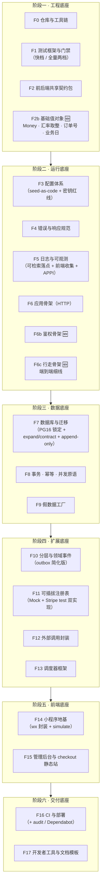
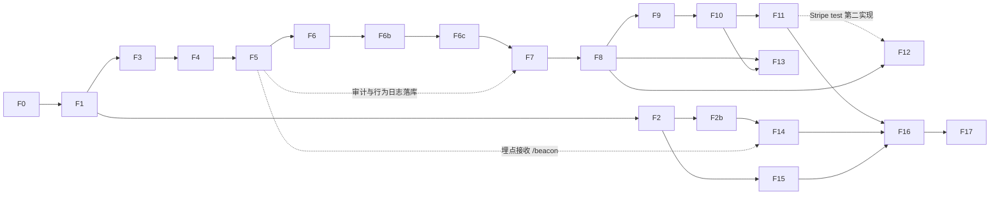

# 地基搭建清单：写业务代码之前要搭好的能力与框架

> 状态：**已定**（v1.2，2026-09-22：开工前两件事已确认 + 外部评审 15 条裁决采纳）｜ 适用：`jp_project` 全部子项目
> 约束来源：`CLAUDE.md` 七条硬约束；细则见 `docs/测试策略与验证门禁.md`、`docs/可扩展架构设计-支付可插拔·多国家·UI可配置.md`、`docs/代码注释规范与日志体系设计.md`
> 上游契约：《技术文档 v0.5》《api-contract.yaml 0.5.0》《工程框架文档 v0.5》

---

## 0. 结论

地基一共 **20 项能力，分 6 个阶段**，全部是"不含任何业务规则"的通用能力：测试与门禁、共享契约、基础值对象、配置、错误、日志、鉴权、行走骨架、数据库与迁移、事务与幂等、假数据、分层与事件、可插拔注册表、外部调用、调度器、小程序与后台前端地基、CI 与部署。

每一项都有自己的测试，而且要先证明"规则真的会拦住违规"（比如故意写一行违规代码，lint 必须报红）。地基全部通过之后，才开始写第一个业务单元。预计 **12–18 个工作日**（v1.2 上调，见 §6）。

### v1.2 三大结构性调整（针对外部评审指出的两个核心缺陷）

1. **不横向盖楼，先跑一条"行走骨架"**：阶段二末（F6c）就把「小程序壳 → 空接口 → 写库 → 模拟支付回调 → 同一个 `trace_id` 全程可查」打通，之后每个阶段往这条线上加东西，集成问题不再堆到最后。
2. **抽象不只对着 Mock 验证**：F11 的支付契约测试除 Mock 外，引入 **Stripe test mode 作为第二个真实现**（账号不需公司资料、现在就能开），用真接口检验 Provider 抽象是否合身。
3. **外部验证与地基并行**：新增 §1.1 并行泳道，把收单机构事前相談（R1）、Stripe 账号、转运报价、审核探针准备、域名与 Cloudflare 等不受代码控制的验证单列，与地基同时推进。

> 📌 **总结**：地基的作用是让后面每个业务单元都能"一写完就能测、一出错就能查、一变化就能换"。但地基无法自我证明合理——要用**真实现**（Stripe）和**端到端细线**（行走骨架）来检验它，而不是等最后再接。

---

## 1. 地基全景图

### 1.1 与地基并行的外部验证泳道（v1.2 新增）

不受代码控制、但决定项目成败的验证项，与地基同步推进，**不等地基做完**：

| 验证项 | 前置 | 阻塞关系 | 看板位置 |
|---|---|---|---|
| 向日本收单机构事前相談（R1 流向 + 是否支持小程序支付） | 无 | 决定通道 A 是否成立 | 支付与资金 |
| Stripe Japan **test 账号**开通 + Checkout 托管页走一遍 | 无（不需公司资料） | 支撑 F11 第二实现 | 支付与资金 |
| 转运公司 DDP 报价（EMS / DHL / 転送コム） | 无 | 决定 `shipping_rates` 真实档位 | 商业与运营 |
| 审核探针准备（小程序简介 §14.1、0 円测试商品、版本说明） | **AppID（公司登记 + 商号定稿）** | 硬前置，地基无法替代 | 产品与技术 |
| 域名 + Cloudflare + Render 账号 | 无 | 影响 F16 部署验证 | 产品与技术 |
| 首月周转金方案（R26） | 周会 | 与代码无关 | 公司设立 |

---

## 2. 逐项说明（做什么 · 为什么 · 怎么验证）

### 阶段一　工程底座

| # | 能力 | 具体内容 | 怎么验证（先红后绿） |
|---|---|---|---|
| **F0** | 仓库与工具链 | monorepo（`server` / `miniprogram` / `admin-web` / `checkout-static` / `packages/shared`）；npm workspaces；Node 22 锁版本（`.nvmrc` + `engines`）；TS `strict`；ESLint + Prettier + EditorConfig；pre-commit（lint + typecheck） | 空项目 lint / tsc 通过；**故意写 `any` + 未使用变量，lint 必须报红** |
| **F1** | 测试框架与门禁 | Vitest 四 project（unit / db / contract / e2e）；v8 覆盖率阈值；假时间；固定种子 ID；`npm run gate`；红灯证据留存。**v1.2：门禁两档**——`npm run test:fast`（只跑相关测试，**时间预算 ≤30s**，写单元时执行）+ `npm run gate`（全量，提交前与 CI 执行） | gate 全绿；**改断断言必须非零退出**；覆盖率低于阈值失败；快档超预算时告警 |
| **F2** | 前后端共享契约包 | `packages/shared`：错误码注册表、枚举、由 `api-contract.yaml` 生成的 API 类型；契约漂移检查 | 三端同源引用；**手改 yaml 不重新生成，gate 报红** |
| **F2b** 🆕 | **基础值对象**（v1.2 从"业务"移入地基） | `Money`（整数最小单位 + 币种，禁裸 number）、**汇率换算与取整的唯一函数**、国家码、订单号生成、**JST 业务日**（结算与调度按日本时间算"日"）；全部纯函数、零依赖 | **属性测试（fast-check）**：随机大额样本验证换算取整与逐项加总**永不差 1 分钱**；跨币种互相传入报错；JST 边界（00:00 / 23:59 / 跨月） |

> 📌 阶段一结束时：项目仍无任何功能，但已具备"写错就被拦住"的能力，且金额/取整这类每个业务单元都会用的东西**只有一份实现**。

### 阶段二　运行底座

| # | 能力 | 具体内容 | 怎么验证 |
|---|---|---|---|
| **F3** | 配置体系 | 三层来源：默认值 → 环境变量 → `app_config` 表；zod 校验，缺项拒绝启动。**v1.2**：`app_config` / `country_profiles` / `payment_channels` 内容以 **seed 文件进仓库、随迁移下发**；后台改动必须写审计；**红线：`payment_channels` 的 jsonb 只存 env 变量名，绝不存密钥本体** | 缺必填项拒绝启动并指明哪一项；seed 与库内不一致时 gate 报红；**扫描测试：配置表里出现疑似密钥值即失败** |
| **F4** | 错误与响应规范 | 统一错误类型（带业务码）；错误码注册表与技术文档 §7 同源；统一响应 `{code,message,data?}`；全局错误中间件；未知异常 500 + 完整记录 + 不泄露堆栈 | 每个错误码"抛出 → HTTP 状态 → 响应体"映射测试；未知异常不泄露堆栈 |
| **F5** | 日志与可观测 | pino 结构化；`trace_id` / `req_id`（AsyncLocalStorage 贯穿，含 DB 与外部调用）；统一 `redact()`；三条流接口。**v1.2 补三块**：① **可检索日志落点**（Render 日志不适合 trace 检索 → 选定 Better Stack / Axiom 等，保留 ≥90 天）② **小程序端错误收集**（Sentry 不支持小程序 → RealtimeLogManager + `/beacon` 上报落库）③ **APPI 合规**：隐私政策写明行为数据收集目的与保留期，提供"用户要求删除即清除其 `user_events`"的操作路径 | 脱敏测试表全掩码；**同一请求所有日志 trace_id 一致**；日志捕获器可断言事件；**按 user_id 清除行为记录的接口有测试且有审计** |
| **F6** | 应用骨架（HTTP） | `createApp()` 工厂（测试与生产同一入口）；依赖注入组装；中间件顺序固定：trace → **回调原始报文（JSON 解析之前）** → JSON → CORS → 限流 → 鉴权 → 路由 → 错误；`/healthz`；优雅停机 | supertest 打 `/healthz`；**回调路由拿到的是原始字节**；限流 42901；停机时在途请求完成 |
| **F6b** 🆕 | **鉴权骨架**（v1.2：不再是"占位"） | `wx.login` → 服务端换 openid → 签发 token；**两种身份**（买家 openid / 管理员 email+密码）；权限中间件（买家不可访问 `/admin/*`）；**按身份限流**；管理员登录失败锁定 | 无 token 访问受保护路由 40101；买家 token 访问 admin 接口 403；连续失败 5 次锁定；**两种身份的 token 不能互换** |
| **F6c** 🆕 | **行走骨架（端到端细线）** | 一条贯穿全栈的最小链路：小程序壳按钮 → `POST` 一个探针资源 → 落库一行 → 触发模拟支付回调 → 状态回写 → 全程日志同一 `trace_id`；配套一条 L3 端到端测试 | 一条测试覆盖"请求 → 写库 → 回调 → 状态 → trace 串联"；**故意断掉任一环测试必须失败**；这条测试是每个阶段回归的第一条 |

> 📌 阶段二结束时：一个空服务能启动、能拒绝错误配置、能鉴权、能返回统一错误、**有一条端到端细线证明全栈是通的**，每一次请求都有可追踪日志。

### 阶段三　数据底座

| # | 能力 | 具体内容 | 怎么验证 |
|---|---|---|---|
| **F7** | 数据库与迁移 | 本机真 Postgres（**v1.2：锁定大版本 16**——本机 16.15 / CI 服务容器 / Render 生产库一致）；纯 SQL 迁移（node-pg-migrate）。**v1.2 迁移策略**：生产 **forward-only + expand/contract**（先加新结构 → 双写 → 再删旧结构），`down` 仅用于本地/测试重建；测试库每用例事务回滚；**审计表 append-only**（`order_events` / `admin_audit` 用 DB 角色 `REVOKE UPDATE, DELETE`，必要时加触发器）；只建基础设施表：`app_config`、`country_profiles`、`payment_channels`、`idempotency_keys`、`job_runs`、`user_events`、`admin_audit` | 迁移 up→down→up（本地）结果一致；用例间零污染；**审计表 UPDATE / DELETE 被拒**的测试；CI 与本地 PG 大版本一致 |
| **F8** | 事务 · 幂等 · 并发原语 | `withTransaction()`；行锁（`SELECT … FOR UPDATE`）；`Idempotency-Key`（24h）；事务级 advisory lock；外部调用重试（指数退避 + 上限） | **同键并发 10 次只执行 1 次**；两连接抢锁只有一个成功；事务中途抛错全回滚 |
| **F9** | 假数据工厂 | 工厂函数 + 固定种子；真实场景集（日文商品名、真实重量分布、美国地址多样性、E.164、跨档边界值、Stripe 真实回调形状、微信机构占位形状）；反例库（非法地址、超额订单、重复/迟到回调、退款失败、拒付）；一键灌数据 | 工厂产物通过 schema 校验；边界清单逐项勾选；同一种子两次完全一致 |

### 阶段四　扩展底座（应对业务变化的关键）

| # | 能力 | 具体内容 | 怎么验证 |
|---|---|---|---|
| **F10** | 分层与领域事件 | `domain / ports / adapters / app`；ESLint 强制依赖方向；时钟与 ID 走接口注入。**v1.2 简化**：事件总线先用**进程内同步分发 + 事务后执行**（沿用技术文档 §6.1 的"提交后动作"模式），`order_events` 兼作事件源，**不单独建 outbox 表**；注释写明升级路径（需要跨进程可靠重试时再引入 outbox） | **在 domain 里 import 一个 adapter，lint 必须报红**；订阅者抛错不影响发布方；事务回滚时事件不分发 |

> **F10 进度（2026-09-23，R2-1 第 1 单元）**：目录骨架已建（`server/src/{domain,ports,adapters,events,app}`）
> + **依赖方向规则已进 gate**（`eslint.config.mjs` 的 `LAYER_ROOTS.flatMap(layeringBlocks)`，核心规则
> `no-restricted-imports`）。验收第一条**已达成并做过两次注回验证**：
> 摘掉整条规则 → 5 条红；把 `server/src` 移出作用范围 → "真实代码树也算得出这条规则"1 条红。
> 证据：`test/lint/layering.lint.test.ts`（6 条）+ `test/lint/layering/**` 夹具树（合法 4 / 违规 3）。
> 决策 **AJ-42 / AJ-43 / AJ-44**。
>
> **已完成**：db / identity → `adapters/`；auth → `app/`；webhooks → `ports/`（契约）+ `adapters/`（SQL），
> 并改走**依赖注入**（`createWebhookStore(db)` 在 main.ts 与 e2e harness 装配，`SkeletonDeps.webhooks` 必填）。
> **已完成（2026-09-24）**：idempotency 也拆成 `ports/`（契约 + 纯函数）+ `adapters/`（SQL + 事务），
> 走 `createIdempotencyExecutor(db)` 注入，`SkeletonDeps.idempotency` 必填。
> 事务句柄用**泛型** `IdempotencyExecutor<TTx>`（装配处给 `Db`）——
> 因为 handler 必须在这个事务里写业务 SQL，现在造"通用查询接口"只会造错（AJ-47）。
> **已完成（2026-09-24）**：**领域事件 R2-2**——`ports/events.ts`（契约）+ `adapters/event-bus.ts`
> （进程内同步分发、订阅者失败只落 error 不中断）+ `app/unit-of-work.ts`（**提交之后**才分发）。
> 验收两条都已转成会红的测试：订阅者抛错不影响发布方（unit 12 条）、事务回滚不分发（db 6 条）；
> 顺序另用**假 begin** 断言（unit 3 条）——真库下那是竞态，见 §2 第 14 条。
> 首个订阅者 `app/business-events.ts` 把 `order.created/order.paid` 落成日志，e2e 据此断言"总线真的在流"。
> **已完成（2026-09-24）：Clock / IdGen 端口注入（F10 最后一项）**——
> `ports/clock.ts`（只有 `now(): Date`）+ `adapters/clock.ts`（`systemClock`）+ `test/helpers/fixed-clock.ts`；
> `ports/ids.ts`（只有 `orderSeq()` / `uuid()`）+ `adapters/ids.ts`（`systemIdGen`）+ `test/helpers/stub-id-gen.ts`。
> 两者在 `SkeletonDeps` 里都是**必填**（可选就一定有人不传，然后退回 `new Date()` / `randomUUID()`）。
> 顺带把"单号生成规则"下沉为 **domain 的第一个居民** `domain/order-no.ts`（JST 业务日是**业务规则**）。
> **光有端口拦不住人**，所以另加一条 AST 静态门禁（`eslint.config.mjs` 的 `PURITY_SELECTORS`，
> 核心规则 `no-restricted-syntax`）：业务侧不得直连 `new Date()` / `Date.now()` / `randomUUID()` /
> `Math.random()` / `randomOrderSeq()`；**默认覆盖 `server/src/**`（fail-closed）**，
> 只豁免 `adapters/**`、`logger.ts`、`context.ts`、`app/auth.ts`、`*.test.ts` 这五处（理由写在配置注释里）。
> 验证：在 `skeleton.ts` 里加一句 `Date.now()` → `npm run lint` **exit=1** 并报出行列；
> 把选择器改错一个字符 → 门禁测试 **2 条红**。证据：`test/lint/purity.lint.test.ts`（5 条）
> + `test/lint/purity/**` 夹具（违规 5 / 合法 1）+ e2e 两条新断言（单号日期段 = 注入时钟的 JST 业务日；
> 注入确定性 IdGen 后 id 与单号都是可预先写出的常量）。决策 **AJ-49 / AJ-50**。
> ⚠️ 已知边界：三处仍刻意用真实时间——pino 时间戳、`webhooks.ts` 的 `new Date()` 兜底值
> （它与 DB 时钟做减法）、`app/auth.ts` 的 JWT `iat/exp`（token 有效期对照真实时钟），均已写进注释。
> ⚠️ 已知不彻底：`skeleton.ts` 仍直接依赖 `./adapters/db.js`（`markPaid` 要用事务），
> 所以"业务不认识 SQL"目前只对 webhooks 成立——Db 端口等 domain 真正出现再按真实用法提炼（AJ-44 反向风险③）。
>
> **2026-09-24 补一条 gate 自身的洞（AJ-46）**：搬目录时只扫了 `import`，
> 没扫**配置里写的路径**——`coverage.thresholds` 里 `auth.ts` / `webhooks.ts` 两条键仍指向老路径，
> 而 vitest 对"匹配不到文件的阈值"**不报错也不生效**，于是"webhooks 必须 100%"静默失效、gate 照绿
> （实测：老路径 + 移开守卫 → `npm run cov` **exit=0，零告警**）。
> 已修：阈值表抽成 `vitest.coverage-gates.ts`（唯一事实来源），路径改回 `app/auth.ts` / `adapters/webhooks.ts`，
> 并新增 `test/config/coverage-threshold.unit.test.ts`（unit 层，进 `test:fast`）——
> 每条按文件的阈值键都必须命中 ≥1 个真文件；注回老路径 → 1 条红并点名是哪条键失效。
>
> **F11 进度（2026-09-24，两个单元）**：
> ① `ports/payment.ts`（PaymentProvider + capabilities + ChannelConfig + PaymentRegistry）
> + `adapters/payment/registry.ts`：**配置是唯一开关**（未配置 = 不开放，未注册工厂 = 静默跳过），
> 按 `priority` 排序且同分按 channel 字典序；`get()` 建单必须 enabled，
> `getForRefund()` 禁用后仍可取（仅当 `refundableWhenDisabled`）——**下线只影响新单，不影响老单退款**。
> 注册期不变式：自报 channel 必须与注册键一致；`supportsRefund` 声明与 `refund()` 实现必须同生同灭。
> ② 两个实现跑**同一套契约测试**（`test/contract/payment-provider.contract.ts`）：
> `mock`（in_app，HMAC 验签）与 `stripe-checkout`（copylink + `Stripe-Signature` 官方口径 + 5 分钟容差）。
> 三方本身用假 HTTP 客户端（`test/helpers/fake-stripe-http.ts`），
> 我们自己的建会话 / 编码 / 验签 / 映射 / 换算全部走真实代码。
> 另立 `ports/http-client.ts` + `adapters/http/fetch-client.ts`（**必须带超时**：fetch 默认不超时，
> 支付请求挂死是真实事故形态）。五个新文件覆盖率**全部 100%** 并进闸门。
> **③ 第三单元（2026-09-24 完成，AJ-52/AJ-53）：HTTP 层兑现可插拔**。
> 两条回调路由**合并为 `/pay/callback/{channel}`**（新增通道不再新增路由），
> 新增 `GET /pay/channels`（country/currency/amount_jpy 三个参数**全部必填**）——
> 前端据此渲染支付入口，**不写死通道名与按钮**；下线一个通道改配置即可，无需发版。
> 回调处理逻辑从骨架抽出为 `app/pay-callback.ts`（**只保留一份**，不复制），
> `adapters/payment/channels.ts` 负责"配置 → 注册表"装配（Stripe 三要素不全则**不注册**，
> 以免一个坏通道把整个支付入口列表拖成 500）。
> 注册表新增第三个取用方法 `getForCallback()`：**已下线通道的在途回调仍要落账**
> （用 `get()` 接回调 = 每下线一个通道就静默吞掉一批已付款订单）。
> 契约增量：`/pay/channels`、`ChannelView`、`x-provider-events.stripe`（事件清单不再挂在会被重构的
> summary 文字上，见 §2 第 18 条）+ 双副本同步 + jp 文档库决策 **D-56**。
> 覆盖：`channels.unit` 8 条 / `pay-routes.unit` 13 条 / `pay-callback.unit` 16 条 /
> `pay-channels.e2e` 7 条；四个新文件**全部 100%** 并进闸门。
> ⚠️ 顺手修掉的两处设计债：`mock.ts` 的 event_id **双重 hex 编码**超 `varchar(128)`
> （真库才暴露：所有不带 event_id 的模拟回调都会 500，见 §2 第 20 条）；
> `claim.token ?? ''` 六处**构造上不可达**的兜底收敛成一处响亮失败（§2 第 19 条）。
> ⚠️ 顺手补的 gate 洞：`npm run cov` 原先**不含 contract 层**，Provider 实现根本不进统计
> （见 §2 第 16 条）。决策 **AJ-51 / AJ-52 / AJ-53**。
>
> **F12 进度（2026-09-24，第一单元）**：重试判定做成**纯函数放 `ports/http-client.ts`**——
> `httpStatusKind`（状态码 → 分类）/ `classifyHttpFailure`（异常 → 分类）/ `backoffMs`（指数退避 + 注入抖动）/
> `shouldRetry`（综合判定）。🔒 唯一红线：**POST 无幂等键 → 绝不重试**
> （超时 / 5xx / 网络错误都意味着"不知道上游处理了没"，对会扣款的 POST 重试 = 重复扣款）；
> 429 是唯一例外（上游明确没处理）。抖动由**注入**的 `rand` 提供（ports 受纯度门禁约束，AJ-50）。
> 21 条单测 + 100% 进闸门；注回缺陷（去掉幂等键判定）→ 1 条红。
> **第二单元（2026-09-24 完成）**：策略接进 `adapters/http/fetch-client.ts`。
> ⏱ **总时长预算** `totalBudgetMs`（默认 6s）单独封顶——单次超时 10s × 3 次 = 最坏 30s，
> 而出站调用在**用户正在等的同步链路**上；每次尝试的超时取 `min(单次超时, 剩余预算)`。
> 预算用尽就交出**最后一次的真实结果**（拿到响应就返回，是异常就抛），绝不编造失败。
> 计时日志：每次请求一条 `http_outbound`（result / duration_ms / attempt），
> 每次重试一条 `http_outbound_retry`，不重试时记 `no_retry_reason`；
> URL **只记到 `?` 之前**（查询串可能有 token / 签名），鉴权头不进日志。
> 15 条单测（时钟 / 睡眠 / 抖动全部注入，预算边界可精确编排），100% 进闸门；
> 注回缺陷（去掉预算）→ 3 条红。决策 **AJ-55**。
> ⚠️ 已知缺口：没有熔断（上游长时间故障时每个请求仍各重试满 3 次）——要跨请求状态，属下一单元。
> **第三单元（2026-09-24 完成）**：🔒 **测试环境外网闸门**——
> `test/setup/network-guard.ts`（能力）+ `install-network-guard.ts`（只做安装），
> 由 `vitest.config.mts` 的 `setupFiles` 对**每个测试文件**装上；
> 未放行的出站请求直接抛错（**异步抛**：`fetch` 契约是返回 Promise，同步抛会破坏
> `Promise.all` 与 `expect(...).rejects`）。放行**本机**（localhost/127.0.0.1/::1）——
> 只拦第三方，不拦我们自己的服务，所以 e2e 真起端口不受影响。
> `allowOutbound(prefix, reason)` 的 `reason` **必填**，防止白名单变成随手加。
> ⚠️ 本单元最大的收获是一次**假绿**：模块底部自安装时，"闸门装上了"这条断言是**自证的**
> （测试文件 import 了它，import 就装上了）——注回缺陷（摘掉 setupFiles）**照样全绿**。
> 拆成两个文件后再注回同一个缺陷 → **2 条红**（见 §2 第 21 条）。决策 **AJ-56**。
> ⏳ **待办**：录制 / 回放拦截（只拦第三方）+ **熔断**。
| **F11** | 可插拔注册表 | 通用 Registry（注册 / 查找 / 按能力过滤）；支付 Provider 接口 + 能力声明（币种、国家、入口方式、退款、拒付、下线后可否退款）。**v1.2：两个实现一起验证**——`MockProvider` 与 `StripeProvider(test mode)` 跑**同一套契约测试**；`/pay/callback/:channel` 统一分发；`GET /pay/channels` 按国家和金额返回可用通道；国家侧 `country_profiles` 仓储 + US 一条种子 | Mock 与 Stripe test 均通过共用契约测试；下线通道新单不可见、老单仍可退款；**两套实现的差异（in_app 签名参数 vs 跳转链接、有无拒付）在契约测试里显式体现** |
| **F12** | 外部调用封装 | 三方 HTTP 客户端：超时、重试、计时日志、脱敏；测试中录制 / 回放拦截（只拦第三方，不拦自己的服务） | 超时触发重试并记录次数；**测试环境任何未被拦截的外网请求直接报错** |
| **F13** | 调度器框架 | `runSchedulerOnce()`（测试可直接调用）；事务级 advisory lock；子任务顺序执行 + 各自 savepoint；外部动作事务提交后执行；`job_runs` 心跳 | **两个实例同时 tick，只有一个执行**；一个子任务失败，其余结果保留、心跳不更新 |

### 阶段五　前端底座

| # | 能力 | 具体内容 | 怎么验证 |
|---|---|---|---|
| **F14** | 小程序地基 | 官方 TS 模板 + 类型包；**v1.2：`wx.*` 接口封装层**（所有 wx 调用走封装，测试替换成假实现）；request 封装（trace_id、静默重登并重放、统一错误、超时）；design token（**lint 禁止页面写色值 / 尺寸字面量**）；6 个基础组件；**组件测试用官方 miniprogram-simulate**（Vitest 内跑）；**miniprogram-automator 仅作评估**（需驱动开发者工具，属可选 L4 辅助）；埋点 SDK（批量 `/beacon`、实时日志）；版本更新管理；隐私授权封装；本地存储封装；组件样板页。**v1.2 两项延后**：表单 schema 渲染器（MVP 固定美国地址表单，`country_profiles` 保留为数据）、首页区块渲染器（MVP 固定三类区块 + 数据配置化，不做插件系统）——注释均写明升级路径 | 纯逻辑抽到 `utils/` 用 Vitest 测（请求重放、埋点批量与重试、token 映射）；**页面写色值字面量 → lint 报红**；simulate 测 6 个组件的 props 与事件；组件样板页开发者工具人工验收（L4 登记） |
| **F15** | 管理后台与 checkout 静态站地基 | admin-web：Vite 单页骨架、共享 design token 与 API 类型、统一请求封装、登录占位；checkout-static：`_redirects` + 成功 / 取消 / 失效三张静态页 | `_redirects` 单测（`/o/:id` 正确转发到 `/pay/link`）；后台 API 封装单测 |

### 阶段六　交付底座

| # | 能力 | 具体内容 | 怎么验证 |
|---|---|---|---|
| **F16** | CI 与部署 | GitHub Actions 跑 `npm run gate`（**服务容器固定 postgres:16**）；**v1.2 依赖安全**：CI 加 `npm audit --audit-level=high`（F0 后恢复 audit，不再用 `--no-audit`）+ 开启 Dependabot；`render.yaml`（web + Postgres 付费档 + 每日作业）；部署前自动迁移；环境划分 本地 / 测试 / 预发 / 生产 | 推一个故意失败的提交 **CI 标红**；**引入含已知漏洞的依赖，CI 必须失败**；预发环境迁移成功并可访问 `/healthz` |
| **F17** | 开发者工具与文档模板 | 本地一键启动（起库 → 迁移 → 灌假数据 → 起服务）；`stripe listen` / cloudflared 使用说明；ADR 模板；**单元完成报告模板**（做了什么 / 测了什么 / 门禁结果 / 下一步）；缺陷登记模板（附 trace_id） | 新机器照 README 从零跑通一遍 |

---

## 3. 搭建顺序与依赖

每一项都是一个或几个"最小单元"，按 `CLAUDE.md` 的上限切分；一项的测试全绿，才开始下一项。

---

## 4. 明确不在地基里的（这些是业务代码，地基完成后再写）

商品、地址、订单、订单明细、支付记录、发货这些业务表和它们的路由；**报价与运费取档、关税计算**（P1，`Money` 值对象就位后再写）；汇率快照的**业务规则**（换算函数本身属 F2b 地基）；订单状态机的**具体状态与迁移规则**（通用执行器属 F10）；微信机构真实 Provider（R1 通过后）；上架校验规则；首页、商品详情、购物车、结算、订单等业务页面；管理后台的业务页面。

> ⚠️ v1.2 修订：**鉴权骨架（F6b）与基础值对象（F2b）从"业务"移入地基**——它们是横切能力，晚做会导致每个业务单元各写一版。

---

## 5. 对现有文档的影响

- 基础设施表会让总表数从 13 张增加（`app_config`、`country_profiles`、`payment_channels`、`user_events`、`admin_audit`），需同步升级《技术文档》到 v0.6 的 DDL 与 `api-contract.yaml`（新增 `/pay/channels`、`/pay/callback/:channel`、`/beacon`）。**地基阶段开始前先改文档，再写迁移。**
- v1.2 追加文档修订：`user_events` / `admin_audit` 声明 append-only；隐私政策与法务文本补 **APPI 行为数据目的 + 保留期 + 用户删除路径**；《代码注释规范与日志体系设计》补可检索日志服务与小程序端错误收集方案。
- `duty_rates`（关税表）归入业务第一批，不在地基里。

---

## 6. 工作量与已确认事项

### 6.0 进度（每次提交后更新；✅=gate 全绿并有红灯证据，🟡=部分完成，⬜=未动）

| # | 项 | 状态 | 落点 |
|---|---|---|---|
| F0 | 工具链 | ✅ | tsconfig / eslint / prettier / vitest |
| F1 | 测试框架与门禁 | ✅ | vitest 五层 project + 覆盖率阈值（100% 闸门：money/orderNo/logger/context/redact/idempotency/webhooks；auth 分支≥95% —— N16） |
| F2 | 共享契约 | ✅ | `packages/shared` + `contracts/api-contract.yaml`（双副本待定） |
| F2b | 基础值对象 | ✅ | `money.ts` / `orderNo.ts` / `businessDay.ts` |
| F3 | 配置 | ✅ | `config.ts`（逐字段 + 跨字段校验） |
| F4 | 错误与响应规范 | ✅ | `errors.ts` + 统一错误中间件 |
| F5 | 日志 | ✅ | `logger.ts`（pino）+ `context.ts`（AsyncLocalStorage）+ `redact`（三类口径 AJ-33）+ `process-errors.ts`（N25） |
| F6 | HTTP 骨架 | ✅ | `http.ts`（含优雅关闭 + SIGTERM + 摘流等待 N7）；退出码 15 缺陷（OS 信号编号漏进 successExitCode）已修 `edf16b5`，信号仿真工具 `test/signal-harness.ts` |
| F6b | 鉴权骨架 | ✅ | `auth.ts`（JWT + `aud` + 角色守卫 + is_admin 回源 N9） |
| F6c | 行走骨架 | ✅ | `skeleton.ts` + `miniprogram/` 壳 + 2 个 L3 用例（15 条） |
| F7 | 数据库与迁移 | ✅ | `migrations/001–004` + PG16 版本闸门 + 连接级 lock_timeout（N32） |
| F8 | 事务·幂等·并发 | ✅ | `idempotency.ts` 双模式：`withIdempotencyTx` 单事务（首选）/ `withIdempotency` 栅栏令牌+续期（N1/N2/AJ-36） |
| F9 | 假数据工厂 | 🟡 | rng/catalog/stripe/us-address/entities 工厂已建（含 db 集成用例）；场景集/反例库/一键灌数据待补 |
| F10 | 分层与领域事件 | ✅ | 分层 + 依赖方向（AJ-42/43）+ 事件总线 + 工作单元（AJ-48）+ **Clock/IdGen 端口注入 + 纯度静态门禁**（AJ-49/50）；⚠️ 已知不彻底：业务侧仍看得见 `Db` 类型（`IdempotencyExecutor<Db>`），Db 端口等 domain 有真实用法再提炼 |
| F11 | 可插拔注册表 | 🟡 | **三个单元全部完成**（AJ-51/52/53）：端口 + 能力声明 + 注册表 + 两个实现跑同一套契约测试 + `/pay/callback/{channel}` 统一分发 + `GET /pay/channels` + `getForCallback`（下线通道的在途回调仍落账）+ 装配层 `channels.ts`；新文件覆盖率**全部 100%** 进闸门；红灯证据 5 条。**剩最后一项**：`country_profiles` 仓储 + US 种子（属 R2-3 表 13→17，需先确认表结构，不在此轮做）；通道的国家/币种过滤目前走 `ChannelConfig`，能力已到位、只是数据源还是内置表而非表驱动 |
| F12 | 外部调用封装 | 🟡 | 两个单元：① 重试判定纯函数（`ports/http-client.ts`，22 条单测）——**POST 无幂等键绝不重试**（AJ-54）；② 接进 `fetch-client`（15 条单测）——**总时长预算** 6s 单独封顶、每次超时取 `min(单次, 剩余)`、预算用尽交出最后一次真实结果、计时日志脱敏（AJ-55）。两文件均 100% 进闸门；③ 外网闸门装进 `setupFiles`（6 条用例，含"闸门确实由 setupFiles 装上"）。剩：录制/回放、**熔断** |
| F13 | 调度器框架 | 🟡 | 单元 ①：`ports/scheduler.ts` 端口契约（12 条单测，100% 进闸门）——定死三条口径：整轮一行心跳（`ok=false` 只更新 `last_error`、**不动** `last_success_at`）、错误进库前必须 `oneLineError()`（脱敏+单行+截断 500）、一轮一个 `trace_id` 写进 `job_runs.trace_id`（AJ-57）；红灯证据 3 条。单元 ②：`adapters/scheduler.ts` + `migrations/006`（`job_runs.trace_id`）——**PG 事务级 advisory lock**（`try_` 版本，进程被杀也不漏释放）、锁 ID 走 (int4,int4)+FNV-1a（6 条单测含独立参考向量）、心跳 upsert 用 SQL `coalesce` 表达"失败不动 `last_success_at`"（9 条真库用例，**两个连接池**验双实例互斥，含提交/回滚后自动释放）（AJ-58）；红灯证据 3 条；单元 ③：`app/scheduler.ts` 编排（14 条单测，100% 进闸门）——泛型 `TTx` 全部注入（单测用 `string` 当事务句柄）、job 的 emit **先收集、savepoint 成功才并入整轮**（否则"回滚了但通知已发出"）、`JobLogger` 强制带 `job`（`child` 只认 module/actor）、顺序 `for…await`（AJ-59）；红灯证据 3 条，并实测抓到一处真缺陷（`err_message` 被 `errorLogFields` 覆盖回未脱敏原文）。单元 ④：`app/scheduler-start.ts`（13 条单测 + 5 条真库集成，100% 进闸门）——`setInterval` 常驻、同进程重叠用 `running` 挡（跨进程仍靠 advisory lock）、回调必 catch（否则 `unhandledRejection` 会**终止进程**）、`runImmediately` 默认 false（避开新旧实例重叠期）、`stop()` 不打断在跑的一轮；真库集成**验到接缝**：savepoint 真的回滚了失败 job 的写入、成功 job 的写入真的留下了、双实例只有一个执行、事件真的在提交后才分发（AJ-60）；红灯证据 3 条。**F13 框架完成**，剩：真实 job（超时关单 / 自动签收）与 `main.ts` 接线 |
| F14 | 小程序底座 | 🟡 | 壳已有；wx 封装与 miniprogram-simulate 待补 |
| F15 | 管理后台 / 收银静态页 | ⬜ | |
| F16 | CI 与部署 | 🟡 | `.github/workflows/ci.yml` 已建（npm ci + PG16 service + 完整 `npm run gate`）；render.yaml / audit / Dependabot 属 R4 待办 |
| F17 | 工具与模板 | ⬜ | |

> 状态口径：✅ 必须满足三件事——`npm run gate` 全绿、关键用例做过**注回缺陷变红**验证、文档已同步。
> ✅/🟡 行的「落点」列必须写证据（文件/用例数/决策号），空证据 = 状态不可信（N35 ④ 采纳，LM 层有结构断言）。
> F7/F8 提前于 F6c 完成（真库是端到端测试的前置条件），顺序与编号不一致是刻意的。

> 欠账登记（进度表管不了的散项）：
> - **D32 订单号冲突无重试**（P3）：`randomOrderSeq` 撞唯一约束时直接 500。复核意见曾把它与 D33（小程序幂等键）
>   编号错位导致丢失，N35 ③ 补回。修法已定（唯一冲突重试 3 次 + `crypto.randomInt`），随 I1 建单侧落地。
> - ✅ **N22 回调 retry 态允许并发处理**（P2，**2026-09-23 已落地**）：四态（`new/handled/retry/inflight`）
>   + `processing_until` 租约（10s）+ 栅栏令牌 + 决定不处理时主动交还租约。
>   落点证据：`migrations/005_webhook_processing_lease.sql`、`server/src/webhooks.ts`、
>   `server/src/skeleton.ts`（`inflight` → 503 + `retry-after: 10`）；
>   真库 4 条 + e2e 3 条定向用例；**注回缺陷三次全部变红**（去掉交还 → 2 红；去掉令牌栅栏 → 4 红；退回三态 → 7 红）。
>   决策 AJ-38 / AJ-39 / AJ-40 / AJ-41。
>   ⚠️ 落地过程中被自己的 e2e 抓出一处**新引入的回归**：早到回调走 503 后仍占着租约，
>   导致接下来 10 秒内的重投被判 `inflight` 再吃 503（AJ-39 已修补 `releaseWebhookLease`）。
> - **N17 契约检查单向、只扫一个枚举**（P1，属 F2 既定升级）：`check-contract.mjs` 只查 shared→契约单向，
>   且正则只扫 `enums.ts` 的小写字符串。F2 标 ✅ 但**落点列未写这项**，现登记：随 F2 升级做双向 + 多枚举。
> - **N31 超限报文应 413 而非 400**（P3）：`entity.too.large` 现归 40001。新增 413 系错误码须**三处同源**
>   （shared/errors.ts + 技术文档 §7 + api-contract.yaml），登记在此，随 F4 错误码扩展一起做。
> - **N24 口令无最小长度**（P3，已降 P3）：`auth.ts` 只查上限。属 F6b 管理员登录/改密业务，
>   随该业务入口落地；登记在此避免像 D32 那样丢失。

| 阶段 | 项数 | 估计工作日（v1.2 上调） |
|---|---|---|
| 一 工程底座 | 4（含 F2b） | 1.5–2 |
| 二 运行底座 | 6（含 F6b / F6c） | 2.5–3.5 |
| 三 数据底座 | 3 | 2.5–3 |
| 四 扩展底座 | 4 | 3–4（Stripe 第二实现 +1） |
| 五 前端底座 | 2 | 2–3（wx 封装与 simulate +0.5） |
| 六 交付底座 | 2 | 1 |
| **合计** | **20** | **约 12–18 个工作日** |

> v1.1 的 8–12 天偏低：未计入小程序 TS 编译调试、行走骨架联调，以及每一步人工验收（开发者工具）的往返时间。

开工前两件事（**2026-09-22 已确认**）：

1. ~~测试数据库：默认用 `embedded-postgres`~~ → **本机真 Postgres 16.15**（已在运行，`japan_shop` 已建；另建 `japan_shop_test`），不引入 embedded-postgres（更贴铁律 T-3"依赖要真"）。
2. **GitHub Actions**：默认开启；到 F16 阶段在仓库设置核实启用状态（不阻塞 F0–F15）。推送仍由向在 Mac 上执行。

---

## 附录：v1.2 外部评审 15 条裁决（11 条全盘采纳 + 4 条修正后采纳 + 0 条否决）

| # | 评审意见 | 裁决 | 落点 |
|---|---|---|---|
| 1 | 横向盖楼，端到端太晚 | ✅ 采纳 | 新增 **F6c 行走骨架** + §0 结论第 1 条 |
| 2 | 抽象只对着 Mock 设计 | ✅ 采纳 | **F11 加 Stripe test mode 第二实现** |
| 3 | 最大风险在外部，地基只磨内部 | ✅ 采纳（修正） | 新增 **§1.1 并行泳道**；说明审核探针被 AppID 硬阻塞、R1 / Stripe / 运费报价本就在看板并行 |
| 4 | 鉴权只是占位 | ✅ 采纳 | 新增 **F6b 鉴权骨架** |
| 5 | 基础值对象被当业务 | ✅ 采纳 | 新增 **F2b**（Money / 取整 / 订单号 / JST 业务日）+ fast-check 属性测试 |
| 6 | 小程序端无法自动验证 | ✅ 采纳 | F14 加 **wx 接口封装 + miniprogram-simulate**；automator 列为可选评估 |
| 7 | 日志缺可检索落点 / 前端错误收集 / APPI | ✅ 采纳（三块） | **F5 修订** + §5 隐私政策补充 |
| 8 | "迁移必须可回滚"太天真 | 🟡 修正采纳 | F7：生产 **forward-only + expand/contract**；`down` 仅用于本地 / 测试重建 |
| 9 | 配置表怎么管没说清 | ✅ 采纳 | F3 **seed-as-code + 密钥红线（只存 env 名）** |
| 10 | 审计日志可被改 | ✅ 采纳 | F7 **append-only**（DB 角色 REVOKE UPDATE / DELETE） |
| 11 | 门禁会越跑越慢 | ✅ 采纳 | F1 **两档**（fast ≤30s / gate 全量） |
| 12 | 数据库版本没锁定 | ✅ 采纳 | F7 **统一 PG 16**（本机 / CI 容器 / Render） |
| 13 | 依赖安全没检查 | ✅ 采纳 | F16 **npm audit --audit-level=high + Dependabot**；安装时恢复 audit |
| 14 | 工期偏乐观 | 🟡 修正采纳 | §6 上调至 **12–18 个工作日** |
| 15 | 部分过度设计 | 🟡 修正采纳 | outbox 降级（F10）；表单 schema 与首页区块渲染器延后（F14）；**支付 Registry 与 `country_profiles` 保留**（契约核心 / 成本极低） |

*v1.0（2026-09-22）：首版。v1.1：开工前两件事确认。v1.2：外部评审 15 条裁决采纳（新增 3 项、修订 11 项、工期上调）。*

---

## 附录 B：地基代码外部审查发现的缺陷 —— P0 修复记录（2026-09-23）

审查给出的 6 条"已复现缺陷"全部**写探针复现过**（不是照单全收），另有 4 条环境/工程项。以下均已修复，且每条都做了**注回缺陷 → 红灯 → 还原 → 绿灯**的验证。

| # | 缺陷 | 修复 | 红灯证据（注回缺陷后失败的用例） |
|---|---|---|---|
| 1 | `convert()` 用浮点乘汇率，`1250 × 0.0676` 得 84（精确 85），违反技术文档 §0 的 ×1e8 整数口径 | 删除 `convert()`，改为 `toRateInt()` + `toMinor()`（整数商+余数，half-up） | 去掉 `Math.round(n*RATE_SCALE)` 与安全整数校验 → 5 条失败 |
| 2 | 订单号自增段 `encodeSeq(32**6)` 撞回 `'000000'`，与技术文档 §1「禁止自增」冲突 | 改为 `YYMMDD` + 6 位随机 Crockford Base32；新增 `randomOrderSeq()` | 去掉 6 位日期段校验 → 1 条失败 |
| 3 | `child()` 把**未脱敏**的 extra 存进 base，且 pino 侧绑定造成**重复 JSON 键**，明文覆盖脱敏值 | base 只存脱敏结果；不再建 pino 级 child 绑定 | 2 条失败（含"同一行不出现重复键"） |
| 4 | 上下文经 pino `mixin` 注入，**绕过** `redact()`（`actor: 'admin:bob@example.com'` 明文） | 取消 mixin，改由 emit 单点注入并脱敏 | 2 条失败 |
| 5 | `runWithContext({trace_id: undefined})` 展开的 undefined 把自动生成的 ID 冲掉 | 新增 `compact()` 先剔除 undefined，再补默认 trace_id | 1 条失败 |
| 6 | 调用点传 `{ event: 'x' }` 能改写事件名（日志按 event 聚合即失真） | payload 里 `event` 恒放最后 | 1 条失败 |
| 7 | `listen()` 硬绑 `127.0.0.1` → 容器平台从外部探不到端口，部署健康检查超时 | 新增 `defaultHost()`（默认 `0.0.0.0`，`HOST` 可覆盖） | 1 条失败 |
| 8 | 无 SIGTERM 处理、无优雅关闭 → 部署时存量请求被腰斩 | 新增 `closeServer()`（断空闲连接 + 100ms 清扫器 + 超时强制断开）与 `installShutdownHandlers()` | 3 条失败（含关闭耗时 3129ms → 300ms 的回归断言） |
| 9 | `node-pg-migrate` 从未写进 package.json（装包被信号打断），`npm ci` 会缺迁移工具 | 根 devDependencies 补 `node-pg-migrate`；`pino` 移到 `server`；`@types/express` 移到 devDependencies | `npm ci --dry-run` 已能解析出该包 |
| 10 | 契约检查硬读 `../jp/...` → CI / 新克隆必崩 | 契约副本入 `contracts/api-contract.yaml`，支持 `CONTRACT_PATH`；本机若存在文档库副本则比对内容，漂移即报红 | 人为改一行 → 报"双副本不一致"并给出同步命令 |

另有两项环境闸门：**Postgres 版本**（`assertPostgresMajor(>=16)`，测试库启动时校验，版本不符直接失败）、**测试库连接串**（不再写死本机用户名；优先 `TEST_DATABASE_URL` → 由 `DATABASE_URL` 换库名推导 → 本机 OS 角色名；`resetTestDb` 改为从 `pg_tables` 动态取表名，消除"加新表忘了加名单"导致的跨用例残留）。

**仍然存在的已知问题（不在本次范围，进 P1）**：契约文件在工程库与文档库各存一份（双副本），根治需把权威源迁到工程库、文档库改为引用——涉及跨仓库约定，待确认。

*注：缺陷 1 的整数实现属于**纵深防御**——把它换回浮点除法并不会让属性测试变红（已实验确认），真正的修正是 `toRateInt()`。这一点已写进 `money.ts` 的注释，避免后来者误以为测试已覆盖该风险。*

---

## 附录 C：P1 一致性修复记录（2026-09-23）

P1 的共同特征：**代码与文档/契约差一点、或约束缺位，但没有任何测试会变红**。逐条修复并做红灯验证。

| # | 问题 | 修复 | 红灯证据 |
|---|---|---|---|
| 1 | 管理员 token 有效期 8h，技术文档 §5 写的是 12h | `DEFAULT_TTL_SEC.admin = 12*3600`，测试断言 43200 秒并引条款号 | 改回 8h → 1 条失败 |
| 2 | 未使用 JWT `aud`，不符合 §5 的 `aud=mp` / `aud=admin` | 新增 `AUDIENCE`（user=mp / admin=admin），签发与校验都带上；受众不符 → **40301**（已验签但不属于该入口，返回 401 会让管理端误判登录失效） | 去掉 setAudience → 7 条失败 |
| 3 | 配置只有逐字段校验，组合起来出事故不报错（生产开 mock 通道 = 收真钱走假支付） | 新增 `crossField` 跨字段规则：生产禁 mock（审核模式除外）、启用通道必须有密钥、生产 DATABASE_URL 不得指向 localhost、生产必须声明 CORS_ORIGINS、审核模式必须指定 SKU | 去掉跨字段校验 → 6 条失败 |
| 4 | 数值型配置只有"能解析成数字"一层校验（`SCHEDULER_TICK_MS=0`、`RATE_LIMIT_*=0` 都能启动） | 给 9 个数值项加下限 | 去掉 TICK 下限 → 2 条失败 |
| 5 | `x-trace-id` 只判非空就用 → 客户端可控内容进每一条日志，且绕过 redact | 限制形状 `^[A-Za-z0-9._:-]{8,64}$`，不符即丢弃新建 | 改回只判非空 → 1 条失败 |
| 6 | `err instanceof SyntaxError` 一律归 40001 → 后端自己的 bug 被当成"用户传参错" | 只认 body-parser 的标记（`entity.parse.failed` / status=400 / `entity.too.large`）；其余落 50000。**日志不再带请求体片段** | 改回宽判 → 1 条失败 |
| 7 | 外键列无索引（Postgres 不自动建）→ 父表删改退化成子表全表扫描 | 002 迁移补 5 个索引 | 删索引 → 1 条失败 |
| 8 | `orders.status` / `products.status` 无域约束 → 拼错的状态让订单从所有查询里静默消失 | 002 加 CHECK（取值取自 shared 枚举 / 契约）。**`payments.status`、`shipments.status` 刻意不加**——契约未枚举，编一套取值会在契约补全后开始误拒合法数据 | 删约束 → 1 条失败 |
| 9 | 审计记录可改（ADR-29 要求 append-only） | 002 加 `deny_audit_modification` 触发器，覆盖 order_events / user_events / admin_audit | 删触发器 → 1 条失败 |
| 10 | ADR-29 三条日志流中的流 B/C **无表可落**（`user_events` / `admin_audit` 不存在） | 002 新建两表（表数 13→15）。`outbox_events` 不建：v1.2 附录 #15 已裁定 outbox 降级 | 见下"待同步" |

### 本次写测试时抓到的一个自身缺陷（值得记住）

外键索引那条用例，注回缺陷后**没有变红**：`payments` 上有个部分唯一索引 `uq_payments_one_initiated ... WHERE status='initiated'`，首列也是 `order_id`，于是"有没有通用外键索引"被它掩盖了。
修正方式是查询里排除部分索引（`indpred is null`）。**结论：测试写了不等于验到了——只有注回缺陷后真的变红，才算这条用例有效。**

### ⚠️ 待同步到文档库（jp）

1. 技术文档 §3 的"13 张表"需补 `user_events` / `admin_audit`（现为 15 张）。
2. `payments.status` / `shipments.status` 建议在 api-contract 0.6 补枚举，之后再以 003 迁移加 CHECK。
3. 契约双副本问题（见附录 B）仍待定。
