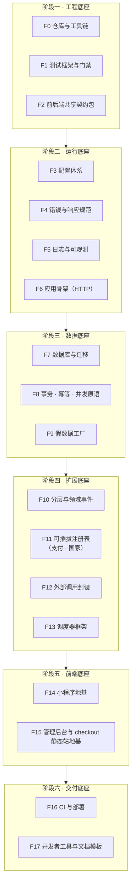
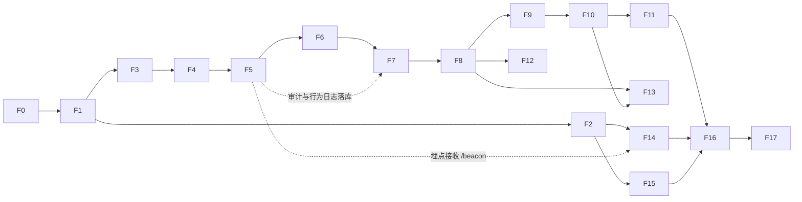

# 地基搭建清单：写业务代码之前要搭好的能力与框架

> 状态：**已定**（v1.1，2026-09-22：开工前两件事已按建议确认）｜ 适用：`jp_project` 全部子项目
> 约束来源：`CLAUDE.md` 七条硬约束；细则见 `docs/测试策略与验证门禁.md`、`docs/可扩展架构设计-支付可插拔·多国家·UI可配置.md`、`docs/代码注释规范与日志体系设计.md`
> 上游契约：《技术文档 v0.5》《api-contract.yaml 0.5.0》《工程框架文档 v0.5》

---

## 0. 结论

地基一共 **17 项能力，分 6 个阶段**，全部是“不含任何业务规则”的通用能力：测试与门禁、配置、错误、日志、数据库与迁移、事务与幂等、假数据、分层与事件、可插拔注册表、调度器、外部调用封装、前后端共享契约、小程序与后台的前端地基、CI 与部署。

每一项都有自己的测试，而且要先证明“规则真的会拦住违规”（比如故意写一行违规代码，lint 必须报红）。地基全部通过之后，才开始写第一个业务单元。预计 **8–12 个工作日**。

> 📌 **总结**：地基的作用是让后面每一个业务单元都能“一写完就能测、一出错就能查、一变化就能换”。地基不稳，业务代码写得越多，返工越多。

---

## 1. 地基全景图

> 📌 **总结**：从下往上盖——先有能测试的工程，再有能跑、能记日志的服务，再有能存数据的库，再有能换零件的架构，最后是前端和交付。

---

## 2. 逐项说明（做什么 · 为什么 · 怎么验证）

### 阶段一　工程底座

| # | 能力 | 具体内容 | 为什么必须先做 | 怎么验证（先红后绿） |
|---|---|---|---|---|
| **F0** | **仓库与工具链** | monorepo：`server/` `miniprogram/` `admin-web/` `checkout-static/` `packages/shared/`；npm workspaces；Node 22 锁版本（`.nvmrc` + `engines`）；TypeScript `strict`；ESLint + Prettier + EditorConfig；pre-commit 钩子（lint + 单元测试） | 所有后续代码的格式、类型、风格从第一行就统一，事后改代价极高 | 空项目 `tsc` / `lint` 通过；**故意写一个 `any`、一个未使用变量，lint 必须报红** |
| **F1** | **测试框架与门禁** | Vitest 分 L0（单元）/ L1（数据库集成）/ L2（契约）/ L3（端到端）四个 project；v8 覆盖率阈值写进配置；假时间（`vi.setSystemTime`）；固定种子的 ID 生成器；`npm run gate` 串行执行全部检查；红灯证据留存脚本 | “没有绿灯不写下一步”要靠命令强制，不靠自觉 | 放一个示例测试：通过时 gate 退出码 0；**把断言改错，gate 必须非零退出并中断**；覆盖率低于阈值时 gate 失败 |
| **F2** | **前后端共享契约包** | `packages/shared`：错误码注册表、订单状态 / 货币 / 渠道等枚举、由 `api-contract.yaml` 自动生成的 API 类型（openapi-typescript）；契约漂移检查（yaml 改了而类型没重新生成，gate 失败） | 前端、后端、后台三处用同一份类型，接口改动编译期就报错，而不是上线后才发现 | 生成的类型能被 server 和 admin-web 同时引用；**手改 yaml 不重新生成，gate 必须报红** |

> 📌 **阶段一总结**：这一阶段结束时，项目还没有任何功能，但已经具备“写错就被拦住”的能力。

### 阶段二　运行底座

| # | 能力 | 具体内容 | 为什么 | 怎么验证 |
|---|---|---|---|---|
| **F3** | **配置体系** | 三层来源：代码默认值 → 环境变量（只放密钥和环境差异）→ `app_config` 配置表（开关、UI 变体、审核模式）；启动时用 schema（zod）校验，缺项或类型错直接拒绝启动；`.env.example` 与 schema 一致性检查；配置变更写审计 | “改配置代替改代码”是应对业务变化的第一手段；配置错必须在启动时暴露，而不是运行到一半 | 缺一个必填项，服务**拒绝启动**并指出是哪一项；`.env.example` 少一项，gate 报红 |
| **F4** | **错误与响应规范** | 统一错误类型（带业务码）；错误码注册表与技术文档 §7 同源；统一响应形状 `{code, message, data?}`；全局错误中间件；未知异常一律 500 + 完整记录 + 不向用户泄露堆栈 | 前端和日志都只认一种错误格式，定位问题不用猜 | 每个错误码都有“抛出 → HTTP 状态 → 响应体”的映射测试；未知异常不泄露堆栈的测试 |
| **F5** | **日志与可观测** | `pino` 结构化日志；`trace_id` / `req_id` 中间件（`AsyncLocalStorage` 贯穿整个请求，含数据库与外部调用）；统一 `redact()` 脱敏；三条流的写入接口：运行日志 / 业务审计（落库）/ 用户行为（落库）；Sentry 封装（复用脱敏）；慢查询与慢调用告警；**测试用日志捕获器**（能断言“某事件已记录”） | 出问题靠日志定位；用户行为缺失就无法分析转化 | 脱敏测试表：邮箱、电话、地址、openid、token、卡号全部被掩码；**同一请求的所有日志 trace_id 一致**；日志捕获器能断言事件 |
| **F6** | **应用骨架（HTTP）** | `createApp()` 工厂（测试与生产同一入口）；依赖注入的组装层；中间件顺序固定：trace → 支付回调原始报文（在 JSON 解析之前）→ JSON → CORS → 限流 → 鉴权占位 → 路由 → 错误；`/healthz`；优雅停机 | 中间件顺序错一次（例如回调报文被提前解析）就会导致验签永远失败，必须一开始写死并测试 | supertest 打 `/healthz`；**回调路由拿到的是原始字节**的测试；限流超阈值返回 42901；停机时在途请求完成 |

> 📌 **阶段二总结**：这一阶段结束时，一个空服务能启动、能拒绝错误配置、能返回统一错误、每一次请求都有可追踪的日志。

### 阶段三　数据底座

| # | 能力 | 具体内容 | 为什么 | 怎么验证 |
|---|---|---|---|---|
| **F7** | **数据库与迁移** | 本地真 Postgres（`embedded-postgres`，无需管理员权限）；纯 SQL 迁移（node-pg-migrate，每个迁移有 up / down）；测试库每个用例事务回滚；`db:test:reset`；迁移后 schema 快照比对；**只建基础设施表**：`app_config`、`idempotency_keys`、`job_runs`、`user_events`、`admin_audit`、`outbox_events`、`country_profiles`、`payment_channels` | 铁律“数据库用真的”要有能随时起停的真库；迁移必须可逆，否则上线回滚不了 | 迁移 up → down → up 三次结果一致；**两个用例之间数据零污染**；故意写一个不可逆迁移，检查脚本报红 |
| **F8** | **事务 · 幂等 · 并发原语** | `withTransaction()`；行锁辅助（`SELECT … FOR UPDATE`）；`Idempotency-Key` 中间件（24 小时）；advisory lock 封装（事务级）；外部调用重试策略（指数退避 + 上限） | 支付回调、超时关单、重复点击三者会并发打到同一订单；这些原语写错一次就是重复扣款或超卖 | **同一个幂等键并发 10 次，只执行 1 次**；两个连接抢同一把锁只有一个成功；事务中途抛错，数据全部回滚 |
| **F9** | **假数据工厂（fixture）** | 工厂函数 + 固定种子；真实场景数据集：日文商品名与真实重量分布、美国地址多样性（公寓号、两行地址、9 位邮编、各州）、E.164 电话、跨运费档位边界值、Stripe 真实回调报文形状（从测试模式录制）、微信机构回调形状（拿到文档前用占位结构并标注）；反例库（非法地址、超额订单、重复回调、迟到回调、退款失败、拒付）；开发环境一键灌数据 | 没有真实数据时，fixture 就是“真实世界”；fixture 失真，测试全绿也没有意义 | 工厂产物全部通过 schema 校验；地址样本覆盖清单逐项勾选；同一种子两次生成结果完全一致 |

> 📌 **阶段三总结**：这一阶段结束时，每个测试都跑在真数据库上、彼此不干扰，而且有一整套像真的一样的假数据可以用。

### 阶段四　扩展底座（应对业务变化的关键）

| # | 能力 | 具体内容 | 为什么 | 怎么验证 |
|---|---|---|---|---|
| **F10** | **分层与领域事件** | 目录 `domain/`（纯逻辑，零依赖）· `ports/`（接口）· `adapters/`（实现）· `app/`（组装）；ESLint 强制依赖方向（domain 不许引用任何 adapter 和框架）；时钟、ID 生成器也走接口注入；领域事件总线 + outbox（事件先随事务落库，提交后分发，订阅者失败可重试） | 业务与功能解耦的物理保证：加通知渠道 = 加一个订阅者，订单代码不动 | **在 domain 里 import 一个 adapter，lint 必须报红**；订阅者抛错不影响发布方，重试后成功；事务回滚时事件不分发 |
| **F11** | **可插拔注册表** | 通用 `Registry`（注册 / 查找 / 按能力过滤）；**支付**：Provider 接口加能力声明（币种、国家、入口方式、是否支持退款 / 拒付、下线后能否退款）、`/pay/callback/:channel` 统一分发、`GET /pay/channels` 按国家和金额返回可用通道、**一套所有 Provider 共用的契约测试**；MockProvider 作为第一个实现；**国家**：`country_profiles` 仓储 + US 一条种子（值等于现在的硬编码规则） | 将来增删支付方式、接新国家，只改配置和新增一个文件 | Mock 通过共用契约测试；**再注册一个假的第二通道，同一套测试也通过**（证明真的可插拔）；下线一个通道后新单看不到它、老单仍可退款 |
| **F12** | **外部调用封装** | 统一的三方 HTTP 客户端：超时、重试、计时日志、脱敏；测试中用录制 / 回放拦截（只拦第三方，不拦自己的服务） | Stripe、微信机构、Zonos、邮件服务的调用方式统一，出问题日志格式一致 | 超时触发重试并记录次数；**测试环境里任何未被拦截的外网请求直接报错**（防止测试偷偷连真服务） |
| **F13** | **调度器框架** | `runSchedulerOnce()`（测试可直接调用）；事务级 advisory lock；子任务顺序执行 + 各自 savepoint；外部动作在事务提交后执行；`job_runs` 心跳；`/internal/jobs/daily` 触发口（技术文档 §6.1 已定） | 超时关单、自动签收都靠它；它静默停摆等于集体失效 | **两个实例同时 tick，只有一个执行**；一个子任务失败，其他子任务结果保留、心跳不更新 |

> 📌 **阶段四总结**：这一阶段结束时，支付方式、国家、通知渠道都已经是“插件”，业务核心不认识任何具体的支付公司或国家。

### 阶段五　前端底座

| # | 能力 | 具体内容 | 为什么 | 怎么验证 |
|---|---|---|---|---|
| **F14** | **小程序地基** | 官方 TS 模板 + 类型包；`request.ts`（注入 trace_id、登录过期静默重登并重放、统一错误处理、超时）；**design token**（`theme.ts` + CSS 变量，lint 禁止在页面写色值和尺寸字面量）；6 个基础组件；**页面区块渲染器**（首页按后端下发的 sections 类型查组件表渲染）；**表单 schema 渲染器**（地址表单按国家模板渲染）；文案表；**行为埋点 SDK**（批量上报 `/beacon`、实时日志）；版本更新管理；隐私授权封装；本地存储封装（购物车持久化用）；组件样板页（开发者工具里集中查看所有组件） | UI 不写死的物理保证；埋点从第一天就有，不会事后补不全 | 纯逻辑抽到 `utils/` 用 Vitest 测（请求重放、埋点批量与重试、schema 渲染映射）；**页面里写一个色值字面量，lint 报红**；组件样板页在开发者工具人工验收（L4 清单登记） |
| **F15** | **管理后台与 checkout 静态站地基** | admin-web：Vite 单页骨架、共享 design token 与 API 类型、统一请求封装、登录占位；checkout-static：`_redirects` 规则 + 成功 / 取消 / 失效三张静态页 | 与小程序共用一套类型和视觉变量 | `_redirects` 规则单测（`/o/:id` 正确转发到 `/pay/link`）；后台 API 封装单测 |

> 📌 **阶段五总结**：这一阶段结束时，改颜色、调首页模块顺序、加一个国家的地址表单，都不需要改页面代码。

### 阶段六　交付底座

| # | 能力 | 具体内容 | 为什么 | 怎么验证 |
|---|---|---|---|---|
| **F16** | **CI 与部署** | GitHub Actions 跑 `npm run gate`（自带 Postgres 服务容器），红灯禁止合并；`render.yaml`（web + Postgres 付费档 + 每日作业）；部署前自动执行迁移；环境划分：本地 / 测试 / 预发 / 生产 | 本地漏跑时 CI 兜底；部署步骤写成文件，不靠记忆 | 推一个故意失败的提交，**CI 必须标红**；预发环境迁移成功并能访问 `/healthz` |
| **F17** | **开发者工具与文档模板** | 本地一键启动（起数据库 → 迁移 → 灌假数据 → 启动服务）；`stripe listen` / `cloudflared` 使用说明；ADR 模板；**单元完成报告模板**（做了什么 / 测了什么 / 门禁结果 / 下一步）；缺陷登记模板（附 trace_id） | 让每一步的交付格式固定，你只需要看报告回“继续” | 新机器照着 README 从零跑通一遍 |

> 📌 **阶段六总结**：这一阶段结束时，任何一次提交都会被自动检查，任何一次交付都有固定格式的报告。

---

## 3. 搭建顺序与依赖

每一项都是一个或几个“最小单元”，按 `CLAUDE.md` 的上限切分；一项的测试全绿，才开始下一项。

---

## 4. 明确不在地基里的（这些是业务代码，地基完成后再写）

商品、地址、订单、订单明细、支付记录、发货这些业务表和它们的路由；报价与运费取档、关税计算、汇率快照；订单状态机与超时关单的具体规则；Stripe 与微信机构的真实 Provider；上架校验规则；首页、商品详情、购物车、结算、订单等业务页面；管理后台的业务页面。

地基只提供“框架”：例如状态机的**通用执行器**是地基，订单有哪些状态、怎么迁移是业务；Provider 的**注册表和契约测试**是地基，Stripe 的具体实现是业务。

---

## 5. 对现有文档的影响

- 基础设施表会让总表数从 13 张增加（`app_config`、`country_profiles`、`payment_channels`、`user_events`、`admin_audit`、`outbox_events`），需要同步升级《技术文档》到 v0.6 的 DDL 与 `api-contract.yaml`（新增 `/pay/channels`、`/pay/callback/:channel`、`/beacon`）。地基阶段开始前先改文档，再写迁移。
- `duty_rates`（关税表）归入业务第一批，不在地基里。

---

## 6. 工作量与开工前需要确认的两件事

| 阶段 | 项数 | 估计工作日 |
|---|---|---|
| 一 工程底座 | 3 | 1–1.5 |
| 二 运行底座 | 4 | 2 |
| 三 数据底座 | 3 | 2–2.5 |
| 四 扩展底座 | 4 | 2–3 |
| 五 前端底座 | 2 | 1.5–2.5 |
| 六 交付底座 | 2 | 0.5–1 |
| **合计** | **17** | **约 8–12 个工作日** |

开工前两件事（**2026-09-22 已确认**，按建议执行）：

1. ~~测试数据库：默认用 `embedded-postgres`~~ → **已改为本机真 Postgres 16.15**：本机实测已在运行且 `japan_shop` 已建；另建 `japan_shop_test` 作测试库，不引入 embedded-postgres（更贴铁律 T-3「依赖要真」）。
2. **GitHub Actions**：默认开启；到 F16 阶段在仓库设置里核实启用状态（不阻塞 F0–F15）。推送仍由向在 Mac 上执行。

*v1.0（2026-09-22）：首版。v1.1（2026-09-22）：开工前两件事确认。*
