# 基座评审报告与解决方案（2026-09-23）

> 评审对象：`jp_project` HEAD `b8eeec4`（42 次提交，含第一轮评审后的 P0 / P1 修复、防复发机制、F6c 行走骨架、F9 假数据工厂）
> 评审范围：基座框架、逐模块代码、测试框架、日志框架、工程架构、对业务变化的灵活支持度、安全、小程序端、假数据
> 评审方式：全量读代码 + 在隔离副本上复跑完整门禁 + **写探针实测每一条可疑缺陷**（凡标「已复现」的都有实测输出，不是推测）
> 约束：本次**只评审、不改代码**；所有探针都在隔离副本里运行，未触碰仓库

---

## 0. 一页结论

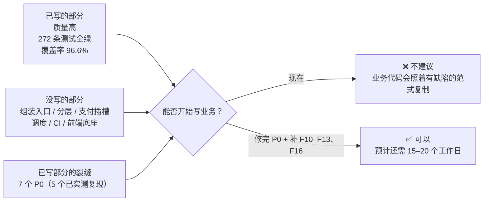

**📌 一句话结论：地基已经浇好的那一半质量很高，但"能跑起来的那根主梁"（生产入口、分层、支付插槽、调度、CI）还没浇，已浇部分还有 7 处会被业务代码照抄放大的裂缝。先修 P0、补齐扩展底座，再写业务。**

| 维度 | 评分（5 分制） | 通俗结论 |
|---|---|---|
| 代码质量（已写部分） | **4.5** | 注释把"为什么 / 缺点 / 取舍"讲得非常清楚，边界处理细致，第一轮评审的 P0 / P1 修复全部到位 |
| 测试框架 | **4.0** | 四层分工、属性测试、"注回缺陷变红"的验证习惯都很专业；缺故障注入、快档门禁未落地、测试库缺安全闸门 |
| 日志框架 | **3.0** | 流 A（运行日志）可用；但 trace_id 能被调用点篡改、脱敏会误伤业务字段、流 B / C 没有写入器、日志没有落点 |
| 工程架构 | **2.0** | 没有生产入口（组装根），服务**能测但不能部署**；分层目录、依赖方向约束、CI 都还没有 |
| 对业务的灵活支持度 | **1.5** | ADR-28 的注册表和 4 张扩展表都未落地；新增一个支付方式或国家要改 5–7 处，且包括数据库迁移 |
| 安全 | **2.5** | JWT（含 aud）、HMAC 验签、错误不外泄做得扎实；但骨架路由越权、无限流 / CORS、口令 72 字节截断、token 无法吊销 |
| 完成度（按清单验收项） | **约 4 成** | 21 项中：3 项完全达标，11 项部分达标，7 项未开始；进度表标了 12 个 ✅，**口径偏乐观** |

### 0.1 必须先修的 7 个 P0

| # | 问题 | 证据 | 不修会怎样（通俗说） |
|---|---|---|---|
| P0-1 | **没有生产入口（组装根）**：没有 `main.ts`、`build`、`start`，装配只存在于测试 harness | 代码审读 | 服务无法部署；每个业务模块会各自拼装依赖，"测试和生产同一入口"落空 |
| P0-2 | **优雅停机顺序反了**：先关数据库，再等在途请求 | **已复现**：在途请求拿到 500，进程仍以退出码 0 报"停机成功" | 每次发布都可能腰斩正在下单 / 回写支付的请求，而且日志显示一切正常 |
| P0-3 | **BIGINT / NUMERIC 读出来是字符串** | **已复现**：`total_jpy` 类列读回 `"1000"`，`count(*)` 读回 `"2"` | 业务代码写 `a.total_jpy + b.shipping_jpy` 会得到 `"1000500"`——金额拼接事故 |
| P0-4 | **幂等执行器可能永久卡死、且不识别"同键不同请求"** | **已复现**：遗留占位行 → 同键永远 40903；同键不同内容 → 返回旧结果 | 进程崩溃一次，该用户这笔下单永远提示"重复提交"；客户端 bug 复用了键，会被当成成功 |
| P0-5 | **回调范式错误**：重复回调返回 409；验签通过但报文坏返回 500 | **已复现**：重复回调 → 409 / 40902；坏 JSON → 500 | 支付机构把非 2xx 当失败并反复重试、告警，严重时停用回调地址；业务期照抄这个范式，支付状态会丢 |
| P0-6 | **骨架路由越权 + 无环境闸门** | **已复现**：用户 B 能读取、并把用户 A 的订单"模拟支付"成已支付 | 组装根一旦挂上骨架路由，任何登录用户都能把任意订单改成已支付；更大的风险是业务路由照抄"不校验归属"的写法 |
| P0-7 | **进度口径虚高**：12 项标 ✅，其中 9 项未满足清单自身的验收标准 | 对照 §2 逐项核对 | 决策依据失真：以为地基完成了，实际缺主梁 |

> 📌 P0 的共同点：**都是"范式"问题**。骨架代码就是后面所有业务代码的模板，模板里的裂缝会被复制几十次，所以必须在写业务之前修。

---

## 1. 评审方法与复跑结果

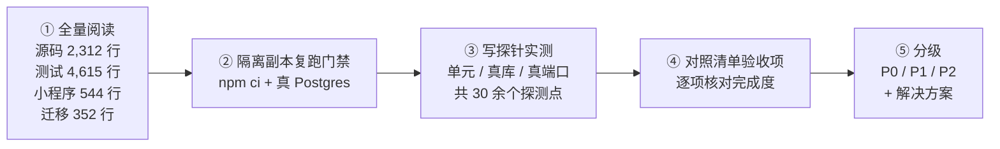

### 1.1 门禁复跑结果（全绿）

| 步骤 | 结果 |
|---|---|
| lint / typecheck | ✅ 通过 |
| check:contract | ✅ 21 个错误码、10 个枚举值（注：只查到订单状态这一个枚举，见 §4.3） |
| test:unit | ✅ 17 个文件 / 218 条 |
| test:db | ✅ 3 个文件 / 39 条 |
| test:contract | ✅ 1 个文件 / 4 条 |
| test:e2e | ✅ 2 个文件 / 15 条 |
| cov | ✅ 272 条；总覆盖率 行 96.59% / 分支 88.2% / 函数 97.43% |

**关键模块覆盖率**（✔ = 已设 100% 闸门）：

| 文件 | 行 | 分支 | 说明 |
|---|---|---|---|
| money.ts / orderNo.ts ✔ | 100 | 100 | 达标 |
| logger.ts / context.ts ✔ | 100 | 100 | 达标（但覆盖率 100% 没有拦住 D8 / D9 的字段覆盖顺序缺陷——覆盖 ≠ 正确） |
| redact.ts | 91.7 | 86.1 | **脱敏是"漏一行就出事故"的模块，却不在 100% 闸门里** |
| auth.ts | 90.7 | 82.9 | 鉴权分支覆盖偏低 |
| idempotency.ts | 100 | 93.8 | 缺"崩溃后遗留占位"的故障注入用例 |
| errors.ts（server） | 100 | 75 | |
| enums.ts | 85.7 | **0** | `isOneOf()` 完全没有被测试执行过 |

### 1.2 环境说明

复跑环境是 Linux 副本 + 嵌入式 Postgres（18 版）。仓库要求 PG 16，版本闸门是 `>=16`，所以能通过——这恰好说明：**本地、CI、生产三处的 PG 大版本目前没有任何机制保证一致**（F16 的 `postgres:16` 服务容器还没建）。

> 📌 门禁本身是健康的：测试真实可跑、结果可复现。问题不在"测试不绿"，而在"绿灯没覆盖到的地方"。

---

## 2. 完成度：对照《地基搭建清单 v1.2》的验收标准

清单自己定义的 ✅ 口径是："gate 全绿 + 关键用例做过注回缺陷变红 + 文档已同步"。但清单每一项还写了**具体内容**和**怎么验证**，本评审按这两栏逐项核对。

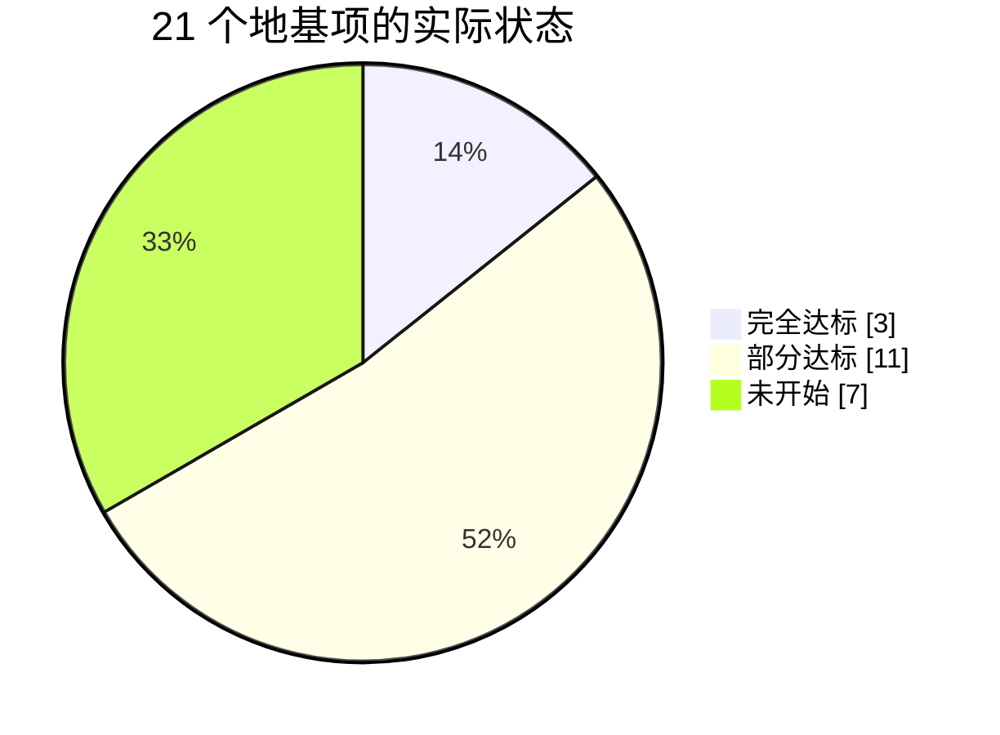

| # | 项 | 进度表 | 实际 | 未达标的验收项（清单原文要求 → 现状） |
|---|---|---|---|---|
| F0 | 工具链 | ✅ | 🟡 | pre-commit（lint + typecheck）→ **无**；ESLint 未启用类型感知规则 |
| F1 | 测试与门禁 | ✅ | 🟡 | 快档 `test:fast` ≤30s 且"写单元时执行" → 脚本存在但**无任何机制强制**；"假时间"→ 未见 |
| F2 | 共享契约 | ✅ | 🟡 | "由 api-contract.yaml 生成的 API 类型；手改 yaml 不重新生成 gate 报红" → **未接入**；漂移检查是子串匹配、单向 |
| F2b | 基础值对象 | ✅ | ✅ | 达标（小瑕疵：`allocate` 接受负数，见 §3） |
| F3 | 配置体系 | ✅ | 🟡 | 三层来源中的 `app_config` 表层、seed-as-code、"配置表出现疑似密钥即失败"的扫描 → **均无** |
| F4 | 错误与响应 | ✅ | ✅ | 达标 |
| F5 | 日志与可观测 | ✅ | 🟡 | 可检索日志落点、小程序 `/beacon`、"按 user_id 清除行为记录的接口有测试且有审计" → **均无**；且清除路径被触发器堵死（已复现） |
| F6 | HTTP 骨架 | ✅ | 🟡 | 中间件顺序要求含 **CORS → 限流** → **均无**；"停机时在途请求完成" → **已复现失败**；`/readyz` → 无 |
| F6b | 鉴权骨架 | ✅ | 🟡 | `wx.login` 换 openid、管理员 email + 密码登录、按身份限流、"连续失败 5 次锁定" → **均无**；现有的是 JWT 签发 / 校验与角色守卫 |
| F6c | 行走骨架 | ✅ | ✅ | 链路达标（安全问题见 P0-6） |
| F7 | 数据库与迁移 | ✅ | 🟡 | 基础设施表 `app_config` / `country_profiles` / `payment_channels` → **无**；"迁移 up→down→up 结果一致" → 无测试；DB 角色 `REVOKE` → 用触发器替代（可接受） |
| F8 | 事务·幂等·并发 | ✅ | 🟡 | 事务级 advisory lock、外部调用重试（指数退避）→ **无**；幂等执行器非原子（已复现） |
| F9 | 假数据工厂 | 🟡 | 🟡 | 进度表写"实体工厂待补"已过时（F9-b/c/d1 已提交）；反例库、一键灌数据、产物按契约 schema 校验 → 无；素材与业务决策冲突（§4.8） |
| F10 | 分层与领域事件 | ⬜ | ⬜ | |
| F11 | 可插拔注册表 | ⬜ | ⬜ | |
| F12 | 外部调用封装 | ⬜ | ⬜ | |
| F13 | 调度器框架 | ⬜ | ⬜ | |
| F14 | 小程序地基 | 🟡 | 🟡 | 只有壳；无 `project.config.json`，开发者工具都打不开 |
| F15 | 管理后台 / checkout 静态站 | ⬜ | ⬜ | |
| F16 | CI 与部署 | ⬜ | ⬜ | |
| F17 | 工具与模板 | ⬜ | ⬜ | |

**缺口按阶段看：**

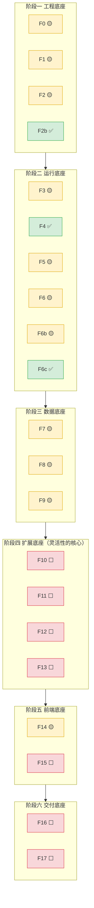

> 📌 **"基座完成了"这个判断不成立**：阶段四（扩展底座）是您提出的"支付方式可换、国家可加、业务解耦"这条要求的全部落点，目前一行没写；阶段六（CI）是"每次提交都被自动检查"的保障，也没有。已完成的主要是阶段一到三，且其中 8 项只做了一部分。

---

## 3. 已复现缺陷清单（探针实测）

> 下表每一条都在隔离副本里写了探针并拿到实际输出。"影响"一栏说的是**业务期照抄或上线后**会发生什么。

| # | 模块 | 缺陷 | 探针与实测输出 | 影响 | 级别 |
|---|---|---|---|---|---|
| D1 | http.ts | 停机时先执行 `beforeClose`（关 DB 池）再 `server.close()` | 慢请求在途时发 SIGTERM → 请求返回 **500**（`write CONNECTION_ENDED`），随后日志 `server_stopped`，退出码 **0** | 发布即丢请求，且被记成"正常停机" | P0 |
| D2 | db.ts | 未配置类型解析 | `int8` → `"9007199254740993"`（字符串），`count(*)` → `"2"`，`numeric` → `"12.50"`；`int4` 才是数字 | 所有金额列（全是 BIGINT）读回字符串，`+` 变拼接 | P0 |
| D3 | idempotency.ts | 占位行无租约、无过期 | 手工留一条 `status_code=0` 的占位（模拟崩溃）→ 同键调用 **永远 40903** | 崩溃一次，该键永久不可用；24h 清理依赖尚不存在的调度器 | P0 |
| D4 | idempotency.ts | 不记录请求指纹，重放不校验路由 / 内容 | 同键先执行 `{amount:100}`，再以不同路由、`{amount:999}` 调用 → 返回 `{amount:100}`，`replayed:true` | 客户端复用键的 bug 被静默吞掉，用户以为下了第二单 | P0 |
| D5 | skeleton.ts | 重复回调按状态冲突处理 | 已支付订单再收一次合法回调 → **409 / 40902** | 机构按失败重试、报警；照抄到 Stripe 回调会触发重试风暴 | P0 |
| D6 | skeleton.ts | 验签通过后 `JSON.parse` 异常未归类 | 合法签名 + 非 JSON 报文 → **500** + `unhandled_error` | 机构侧看到 5xx 会重试同一坏报文 | P0 |
| D7 | skeleton.ts | GET / simulate-paid 不校验订单归属 | 用户 B 读取 A 的订单 → **200**；B 调 simulate-paid → **200**，A 的订单变为已支付 | 越权（IDOR）；更大的风险是业务路由照抄 | P0 |
| D8 | logger.ts | 调用点字段覆盖上下文 | `log.info('x', {trace_id:'FORGED', user_id:'u2'})` → 输出 `trace_id:"FORGED"`、`user_id:"u2"` | 链路追踪可被任意一行代码改写，排障时串错链 | P1 |
| D9 | logger.ts | 上下文 `module` 覆盖 child 绑定 | 请求内 `log.child({module:'payment'})` → 输出 `module:"http"` | 按模块过滤日志失效：请求期间所有模块都显示为 http | P1 |
| D10 | redact.ts | 键名子串匹配误伤 | `company`、`japan_post_no`、`hotel_name`、`panel`、`discard_reason`、`telemetry` 全部被打码 | 业务字段被抹掉，日志失去可定位性（company 含 pan、hotel 含 tel） | P1 |
| D11 | redact.ts | 自由文本正则误伤 | JAN 码 `4901234567894` → `***7894`；毫秒时间戳 → `***0000`；`o_01J8ZK…` 类 ID → `o_***2X` | 商品条码、时间戳、以 o 开头的内部 ID 在日志中不可用 | P1 |
| D12 | redact.ts | 数字类型不脱敏 | `{note: 4111111111111111}`（数字）原样输出 | 卡号以数字形式进日志时漏掩码 | P2 |
| D13 | http.ts | 报文解析错误按 error 级记录为 `unhandled_error`；超限返回 400 | 2MB 报文 → HTTP 400，同时一条 **error 级** `unhandled_error` | 任何人发坏报文都能触发 error 告警（告警噪声 / 可被滥用）；超限应为 413 | P1 |
| D14 | 002 迁移 | `user_events` 禁止 DELETE | `delete from user_events where user_id=…` → 被触发器拒绝 | 与 F5 验收项"用户要求删除即清除其 user_events"（APPI）直接冲突；保留期清理也做不了 | P1 |
| D15 | auth.ts | bcrypt 只取前 72 字节 | 72 个 a + `SUFFIX1` 的哈希，用 72 个 a + `DIFFERENT` 校验 → **通过** | 长口令尾部不参与校验（管理员口令场景） | P1 |
| D16 | config.ts | staging 与 development 同样宽松 | staging 下 `CORS_ORIGINS=not a url`、`CHECKOUT_BASE_URL=nope`、`INTERNAL_JOB_SECRET=1`、`ADMIN_INITIAL_PASSWORD=1` → **全部通过** | 预发环境带着错配置上线，问题到生产才暴露 | P1 |
| D17 | config.ts | `NODE_ENV` 不接受 `test` | `NODE_ENV=test` → 配置校验失败；而 Vitest 默认就设 `NODE_ENV=test` | 测试里无法用 `loadConfig(process.env)`，组装根一接入测试就会撞上 | P1 |
| D18 | shared/money.ts | `allocate` 不校验符号 | `allocate(-100,[1,1])` → `[-50,-50]`；`allocate(100,[-1,3])` → `[-50,150]` | 分摊出负数金额（折扣分摊、退款拆分时） | P1 |
| D19 | 001 迁移 | 邮箱唯一约束区分大小写 | `Bob@Example.com` 与 `bob@example.com` 可同时插入 | 同一管理员两个账号；登录时大小写不一致找不到人 | P2 |
| D20 | db.ts | 无 `statement_timeout` | `show statement_timeout` → `0`（不限时） | 一条慢查询能占住连接直到平台超时 | P1 |
| D21 | http.ts | 无 CORS、无 `/readyz` | 预检 `OPTIONS` → 404、无 `Access-Control-Allow-Origin`；`/readyz` → 404 | admin-web 跨域调用会全部失败；平台无法判断"能否接流量" | P1 |
| D22 | http.ts | 访问日志无客户端 IP；`actor` 只记角色 | 访问日志字段中无 ip；`actor:"user"` | 限流、风控、审计缺关键字段；无法区分是哪个用户做的 | P2 |

**代码审读确认（未单独写探针，但逻辑确定）：**

| # | 缺陷 | 影响 | 级别 |
|---|---|---|---|
| D23 | `trust proxy` 设为 `true`：信任任意层 `X-Forwarded-For` | 将来限流 / 锁定按 IP 计时，客户端伪造一个头就能绕过 | P1 |
| D24 | 幂等的 handler 与"写结果"不在同一事务；handler 成功后若 `update` 失败，占位行永久遗留（同 D3） | 副作用已发生、键却卡死 | P0（并入 P0-4） |
| D25 | JWT 有 `ver` 字段但校验时不比对；不检查 `users.blocked_at` | 封禁用户、改密后旧 token 仍有效（管理员 12h、用户 7 天） | P1 |
| D26 | `issuer` 默认写死 `'waselect'`，未接配置；用户与管理员共用一把密钥、无 `kid` | 无法按环境区分签发者；密钥轮换只能"一刀切"全体下线 | P2 |
| D27 | 测试库连接串没有安全闸门：`resetTestDb` 会 `truncate … cascade` **所有表**，但不校验库名是否以 `_test` 结尾、主机是否本机 | 某天 `TEST_DATABASE_URL` 配错指向真库，一次测试清空全部数据 | P1 |
| D28 | 测试 `afterAll` 里直接 `db.end()`：库连不上时抛 `Cannot read properties of undefined`，**掩盖**真正的 `ECONNREFUSED` | 排障方向被误导 | P2 |
| D29 | 迁移在测试里以 `stdio: 'ignore'` 执行 | 迁移失败时看不到原因 | P2 |
| D30 | `test/factories/stripe.ts` 的 `stripeEvent()`：末尾 `...overrides` 会用 `overrides.data` **整体替换**前面合并好的 `data.object` | 只想改一个字段的样本会丢掉全部默认字段，造出"残缺回调" | P1 |
| D31 | Stripe 样本只有 `payment_intent.*` / `charge.*`；D-49 定的是 **Checkout 托管页**，主事件是 `checkout.session.*` | 回调解析会按错误的事件类型设计 | P1 |
| D32 | 订单号冲突无重试；`randomOrderSeq` 默认 `Math.random` | 冲突时直接 500；单号可预测（若将来按单号查询） | P2 |
| D33 | 小程序 `idempotencyKey: mp-${Date.now()}` 每次点击新建 | 重试不是同一个键，幂等形同虚设 | P1 |
| D34 | 小程序请求把"2xx 且响应体含数字 `code` 字段"判为失败 | 将来某个成功响应带一个名为 code 的数字字段（如优惠码）即被误判 | P2 |

> 📌 34 条里，22 条有实测输出。最该记住的三条：**停机丢请求（D1）、金额读成字符串（D2）、幂等键卡死（D3）**——这三条在测试里全绿，只有到生产才会以"偶发、难复现"的方式出现。

---

## 4. 分领域深度分析

### 4.1 工程架构

**现状 vs 目标：**

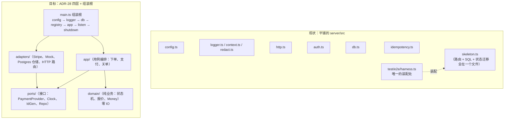

| # | 问题 | 说明 | 级别 |
|---|---|---|---|
| A1 | **没有组装根** | 没有 `main.ts`、没有 `build` / `start` 脚本；`packages/shared` 的 `main` 指向 `src/index.ts`（TS 源码），生产 Node 无法直接加载。清单 F6 要求的"`createApp()` 工厂（测试与生产同一入口）"只实现了一半：`createHttpApp` 有了，但"谁来组装依赖"只在测试 harness 里写了一次 | P0 |
| A2 | 分层目录与依赖方向约束不存在 | `server/package.json` 的描述写着"domain/ports/adapters/app 分层"，实际没有这些目录，也没有 lint 规则阻止 domain 依赖 adapter | P1（F10） |
| A3 | 骨架把路由、SQL、状态迁移写在同一个函数里 | 骨架期可以接受，但它是业务代码的第一个模板；业务期必须拆成 路由（adapter）→ 用例（app）→ 状态机（domain）→ 仓储（adapter） | P1（F10） |
| A4 | 每个路由都手写 `void (async () => { try … catch next(e) })()` | Express 5 已原生把 async handler 的 reject 交给错误中间件，这层样板是多余的，而且新人漏写 `catch` 时会变成未处理的 Promise | P2 |
| A5 | ESLint 未启用类型感知规则 | 用的是 `tseslint.configs.recommended`，没有 `no-floating-promises` / `no-misused-promises` / `switch-exhaustiveness-check`——这三条对"异步 + 状态机 + 支付"代码价值最高 | P1 |
| A6 | 没有 CI | 所有门禁只在本机手动跑；"推一个故意失败的提交 CI 标红"尚不存在 | P1（F16 提前） |
| A7 | ESLint 9 已进入不再维护状态（安装时提示 deprecated） | 不影响当前使用，F16 接入 Dependabot 时一并升级 | P2 |

> 📌 通俗说：零件都造得很精细，但还没有"总装车间"。现在能单独测试每个零件、也能在测试台上把它们接起来跑一圈，却没法把整台机器开出厂。

### 4.2 逐模块代码评审

| 模块 | 做得好的 | 缺陷 / 不足 |
|---|---|---|
| **config.ts** | zod 逐字段 + 跨字段校验；`CONFIG_KEYS` 与 `.env.example` 集合比对（防拼错变量名）；密钥名单化脱敏 | staging 未按生产标准（D16）；URL 类字段不校验格式；`INTERNAL_JOB_SECRET`、`ADMIN_INITIAL_PASSWORD` 无最小长度（`.env.example` 写了 ≥10 位，代码没执行）；`NODE_ENV` 无 `test`（D17）；`app_config` 表层未实现 |
| **http.ts** | trace_id 形状校验（防日志注入）；原始报文优先于 JSON 解析；解析错误不回显请求体；404 / 500 统一形状；空闲连接 100ms 清扫 | 停机顺序（D1）；解析错误的日志级别（D13）；无 CORS / 限流 / `/readyz`（D21）；`trust proxy: true`（D23）；`defaultHost()` 直接读 `process.env.HOST`，与 config 形成两个来源；4xx 每次产生两行日志（`request_rejected` + `http_request`） |
| **auth.ts** | HS256 算法白名单；`aud` 区分小程序与后台；受众不符返回 40301 而非 40101 的理由写得很清楚 | 登录端点、锁定、按身份限流都没有（F6b 大半未做）；`ver` / `blocked_at` 不校验（D25）；72 字节截断（D15）；`issuer` 未接配置（D26） |
| **db.ts** | PG 大版本硬闸门；savepoint 与"嵌套 begin 报错"的明确提示；`ping` 返回布尔值而不抛异常 | 类型解析（D2）；无 `statement_timeout`（D20）；无慢查询日志；连接池参数未进配置 |
| **idempotency.ts** | 唯一约束抢占位的并发语义正确；失败删除占位"不毒化"；有并发用例 | 非原子（D3 / D24）；无请求指纹（D4）；无租约与清理；业务错误（如库存不足 40901）不缓存，重试会重新执行——需要写明这是刻意的 |
| **skeleton.ts** | 回调用原始字节 + `timingSafeEqual`；`for update` 排队并发回调；`paramId()` 收敛 Express 5 参数类型 | 越权（D7）；重复回调 409（D5）；坏报文 500（D6）；无环境闸门；`created → paid` 跳过了 `pending_payment`；回调不校验金额 / 币种（骨架可以，但范式要先立好） |
| **logger.ts / context.ts** | 脱敏在 emit 单点强制执行；`event` 恒放最后；`compact()` 修掉 undefined 覆盖；第一轮 6 条缺陷全部修复并有红灯证据 | 字段优先级（D8 / D9）；流 B / C 无写入 API；无日志落点 |
| **redact.ts** | 键名名单 + 文本正则双层；限制深度与循环引用；Error 摊平；局限写得很诚实 | 子串匹配误伤（D10）；正则误伤（D11）；数字不处理（D12）；不在 100% 覆盖闸门里 |
| **errors.ts（server + shared）** | 错误码字面量联合类型，拼错在编译期报红；非 AppError 一律折叠且不回传 message | 未来新增"幂等键被不同请求复用"等场景需要新码（见 §5） |
| **money.ts** | ×1e8 整数汇率；整数商 + 余数实现 half-up；属性测试 | `allocate` 符号校验（D18）；`CurrencyCode` 与 `CURRENCY` 枚举重复定义；**小数位固定为 2**（`MINOR_DIVISOR=1e6` 隐含 USD / CNY 的"分"），加日元以外的零小数币种（如 KRW）或三位小数币种会算错 |
| **orderNo.ts / businessDay.ts / id.ts** | 形状正则、JST 固定偏移的取舍写得清楚；确定性 ID 工厂修掉了周期塌缩 | 订单号冲突无重试（D32）；生产用的 ID 生成器（ULID / UUID v7）尚无统一出口，骨架里是 `sk-${randomUUID()}` |

> 📌 代码层面的整体印象：**每个函数都想清楚了"为什么"，缺的是"跨函数的约定"**——比如"数据库读出来的数字是什么类型""日志里哪些字段谁说了算""回调遇到重复怎么答"。这些约定应当在基座里定死，而不是留给每个业务单元自己想。

### 4.3 测试框架

**做得好的（保留）：** 四层 project 与命名约定清晰；db / e2e 串行的理由写在配置里；fast-check 属性测试用在金额与 ID；"注回缺陷 → 变红 → 还原"的红灯证据制度；结构不变量元测试（任何外键有索引、任何 status 列有域约束）会对新表自动生效；`resetTestDb` 从 `pg_tables` 动态取表。这些是很多成熟团队都没有做到的。

**缺口：**

| # | 问题 | 说明 | 级别 |
|---|---|---|---|
| T1 | 没有故障注入 | "进程在占位后崩溃""写结果时 DB 断开""回调处理到一半超时"都没有用例，所以 D1 / D3 / D24 在全绿的测试下存在 | P1 |
| T2 | 快档门禁无人执行 | `test:fast` 存在，但没有 pre-commit、没有时间预算告警；CLAUDE.md 约束一"写完立刻测"只靠自觉 | P1 |
| T3 | `gate` 重复跑测试 | 先跑 unit / db / e2e，`cov` 又把三层全跑一遍；现在只多 8 秒，测试量上来后会翻倍 | P2 |
| T4 | `passWithNoTests: true` 仍开着 | 四层现在都有测试了，这个开关的理由（F1 时各层为空）已不成立；留着会让"include 模式写错、一个测试都没匹配上"也通过 | P1 |
| T5 | 契约检查太弱 | 只做子串匹配、单向（代码 → 契约）；枚举正则只匹配多行数组，所以 `PAYMENT_CHANNEL` / `CURRENCY` / `COUNTRY` **根本没被检查**（输出里的"10 个枚举值"全是订单状态）；没有"每个已挂载路由都在契约里"的检查；没有生成类型 | P1 |
| T6 | 测试库安全闸门缺失 | D27 | P1 |
| T7 | 迁移 up → down → up 无测试 | 清单 F7 的验收项；down 脚本写错只会在需要回滚时发现 | P1 |
| T8 | 100% 闸门覆盖面不够 | `redact.ts`、`idempotency.ts`、`auth.ts` 都是"漏一个分支就是事故"的模块，应纳入 | P1 |
| T9 | 没有假时钟 | 关单（30 分钟）、自动签收（30 天）、token 过期都依赖时间；现在代码直接用 `new Date()` / `now()`，将来这些用例只能靠真等或改库 | P1（F10 的 Clock 端口） |
| T10 | 本地 / CI / 生产 PG 版本一致性无保障 | 见 §1.2 | P1（F16） |
| T11 | `afterAll` 掩盖根因、迁移输出被吞 | D28 / D29 | P2 |

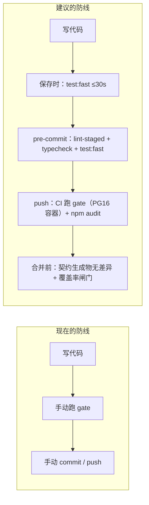

> 📌 测试框架的"骨架"是优秀的，缺的是**两类用例**（故障注入、时间相关）和**两道自动闸门**（pre-commit、CI）。前者决定"绿灯能不能信"，后者决定"绿灯会不会被跳过"。

### 4.4 日志框架

**ADR-29 三条流的落地情况：**

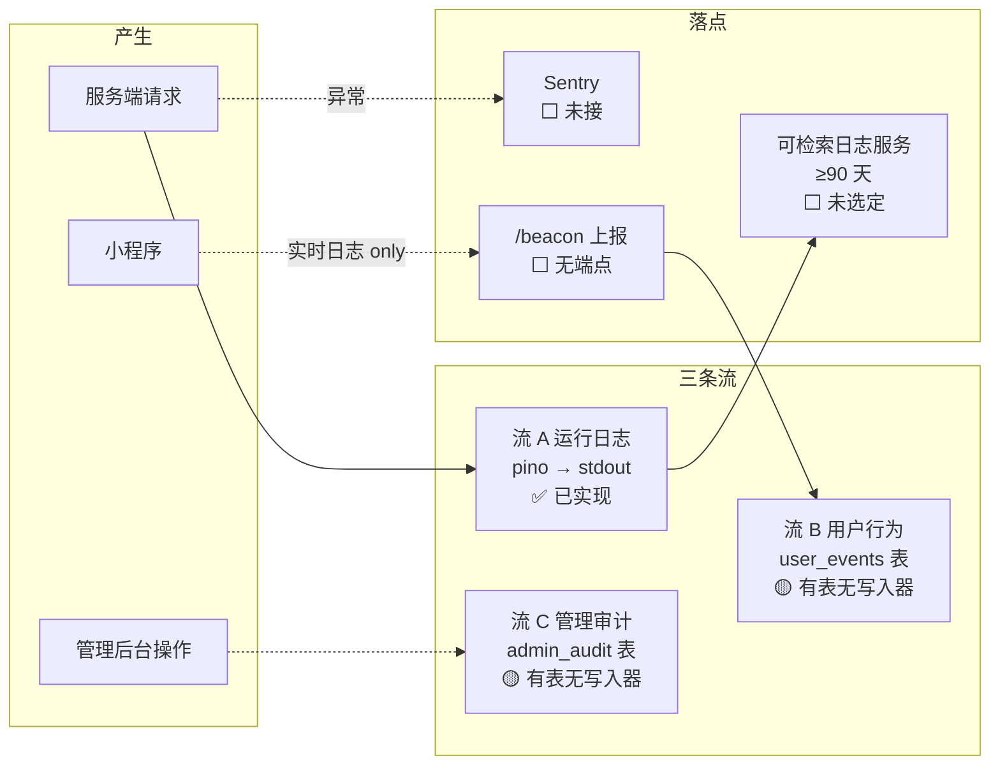

| # | 问题 | 说明 | 级别 |
|---|---|---|---|
| L1 | 字段优先级 | D8 / D9：保留字段（`trace_id` / `req_id` / `user_id` / `actor`）应只能来自上下文；`module` 应由 child 决定 | P1 |
| L2 | 脱敏误伤 | D10 / D11：会让日志失去最有价值的定位字段 | P1 |
| L3 | 流 B / C 无写入器 | 表已建，但没有 `trackUserEvent()` / `auditAdmin()` API，也没有 `/beacon` 端点（契约里也没有）；CLAUDE.md 约束七"不能缺失用户的操作行为"目前无从落实 | P1 |
| L4 | 无落点、无保留期 | 只写 stdout；Render 日志不适合按 trace_id 检索（清单自己写的） | P1 |
| L5 | 前端错误采集 | 小程序无 `App.onError` / `onUnhandledRejection` 采集；只有实时日志 | P1 |
| L6 | `order_events` 无 `trace_id` 列 | 从"订单时间线"跳回"那次请求的完整日志"只能按时间猜 | P2 |
| L7 | 访问日志缺字段 | 无客户端 IP、无响应大小；`actor` 只有角色（D22） | P2 |
| L8 | 4xx 双行日志 | `request_rejected`（warn）+ `http_request`（warn）；聚合时 4xx 数量翻倍 | P2 |
| L9 | 解析错误误报为 error | D13 | P1 |
| L10 | 无采样与日志量控制 | 访问日志全量 info；上量后成本与噪声都会上来（可在落点侧做） | P2 |

> 📌 日志框架的**核心机制（上下文贯穿 + 单点脱敏）是对的**，第一轮的 6 条缺陷也修得干净。现在的问题是"规则还差两条"（保留字段只认上下文、键名按词匹配）和"只有一条流真正在工作"。

### 4.5 数据库与迁移

| # | 问题 | 说明 | 级别 |
|---|---|---|---|
| DB1 | 类型映射 | D2 | P0 |
| DB2 | ADR-28 四张表缺失 | `country_profiles` / `payment_channels` / `app_config` / `duty_rates`。001 迁移的注释写明"需先改技术文档 v0.6 与契约 0.6.0 再加"——**这是一个待拍板的前置决策，不是遗漏**；但它卡住了 F3 / F11 / 灵活性全部工作，需要尽快定 | P1（决策） |
| DB3 | append-only 与 APPI 冲突 | D14；另外 `orders.user_id` 等外键无级联——用户注销不能"删 users 行"，只能"匿名化"，这条路径也还没设计 | P1 |
| DB4 | `payments.status` / `shipments.status` 无域约束 | 附录 C 已登记为待契约补全；在补之前，结构不变量测试用豁免名单放行（做法是对的） | P1（随契约 0.6） |
| DB5 | 无 `statement_timeout`、无慢查询日志 | D20 | P1 |
| DB6 | 邮箱大小写 | D19；建议 `citext` 或 `lower(email)` 唯一索引 | P2 |
| DB7 | `updated_at` 靠应用自觉写 | 骨架里是手写 `updated_at = now()`；漏写就不准，建议触发器 | P2 |
| DB8 | 地址格式 CHECK 写死美国 | 电话 `^\+1…`、邮编五位数写在数据库约束里；新增国家需要迁移（见 §4.9） | P1（F11 / 国家档案） |
| DB9 | 迁移 up→down→up 未验证 | T7 | P1 |

### 4.6 安全

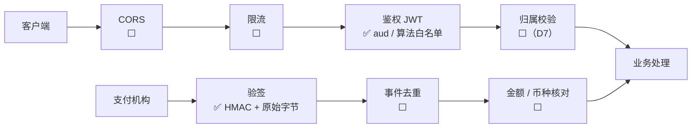

| # | 问题 | 级别 |
|---|---|---|
| SEC1 | 归属校验缺失（D7），且没有可复用的"按当前用户取资源"的仓储范式 | P0 |
| SEC2 | 骨架路由无环境闸门：`simulate-paid` 注释写"业务期必须删除"，但没有代码层保证 | P0 |
| SEC3 | 无限流、无 CORS；`trust proxy: true` 可伪造 IP（D21 / D23） | P1 |
| SEC4 | 管理员登录与锁定未实现；bcrypt 72 字节（D15） | P1 |
| SEC5 | token 无法吊销（D25）；无密钥轮换（D26） | P1 |
| SEC6 | 回调无事件去重、无金额核对（骨架可以，范式必须先立） | P0（并入 P0-5） |
| SEC7 | 无安全响应头（`X-Content-Type-Options`、`Referrer-Policy` 等）；API 只返 JSON，风险较低 | P2 |
| SEC8 | 依赖安全扫描未接（F16 的 `npm audit` + Dependabot） | P1 |

### 4.7 小程序端与前端底座

| # | 问题 | 说明 | 级别 |
|---|---|---|---|
| MP1 | 缺 `project.config.json` / `sitemap.json` | 开发者工具无法打开，L4 真机验证无从开始；ES Module 语法也依赖工程配置 | P1 |
| MP2 | 幂等键每次点击新建（D33） | 应在"一次用户意图"开始时生成，重试复用 | P1 |
| MP3 | 请求无超时设置 | `wx.request` 默认超时很长，弱网下用户会长时间卡住 | P1 |
| MP4 | 无 40101 静默重登并重放 | 清单 F14 要求；token 7 天过期后用户会看到报错 | P1（F14） |
| MP5 | 环境切换 | `API_BASE` 写死 `http://localhost:3000`；可用 `wx.getAccountInfoSync().miniProgram.envVersion`（develop / trial / release）映射三套地址 | P1 |
| MP6 | 无全局错误采集 | L5 | P1 |
| MP7 | 未使用 shared 契约 | 纯 JS，错误码 / 枚举 / 接口形状与服务端无编译期联系；至少应生成一份 JS 常量或启用 `checkJs` + JSDoc 类型 | P1 |
| MP8 | 设计令牌无约束 | `app.wxss` 已有 `--ws-*` 变量（方向对），但没有 lint 禁止页面写色值 / 尺寸字面量（清单 F14 验收项），约束五"UI 不写死"没有机器保证 | P1（F14） |
| MP9 | 成功判定依赖"有无数字 code 字段"（D34） | 建议统一约定：成功体不含 `code`，或统一 `{code:0,data}` 两者择一并写进契约 | P2 |
| MP10 | admin-web / checkout-static 不存在 | F15 | P1（F15） |

### 4.8 假数据工厂

**做得好的：** 确定性 PRNG；实体工厂产物"必须真插进真库"；Stripe 签名按官方口径造、并用独立实现交叉验签避免自证；金额只造 JPY 零小数单位并写明原因。

| # | 问题 | 与哪条决策冲突 | 级别 |
|---|---|---|---|
| FX1 | 商品素材含**獺祭（清酒）** | D-51 与契约 `compliance_tags` 描述：alcohol 上架即拒、不可邮寄；工厂自己的注释也写"不含酒类" | P1 |
| FX2 | 类目用了 `lifestyle` | 契约类目枚举是 `[beauty, daily, kitchen, food]` | P1 |
| FX3 | 运费阶梯 `500→1980 …` | 与技术文档中的测试向量（`100→1400`、`250→1650` …）不一致；两套数字并存，业务期不知道以谁为准 | P1 |
| FX4 | `pickTier()`（取档规则）写在测试代码里 | 取档是业务规则，应在 domain 实现一次、测试引用它；否则测试在验证"测试自己的实现" | P1 |
| FX5 | 美国地址缺边界样本 | 缺撇号姓名（O'Brien）、军邮 APO / FPO（州码 AA / AE / AP）、PO Box、夏威夷 / 阿拉斯加、ZIP+4、超长 line2 | P1 |
| FX6 | Stripe 样本缺 `checkout.session.*`；`overrides` 合并缺陷 | D30 / D31 | P1 |
| FX7 | 反例库、一键灌数据、按契约 schema 校验产物 | 清单 F9 验收项 | P1 |
| FX8 | JAN 码为占位值、`makeUser` 的 openid 形如 `o-fixture-1` | 与真实形状（13 位带校验位的 JAN、28 位 openid）不同，会漏掉脱敏 / 校验相关的问题（D11 就是例子） | P2 |

> 📌 CLAUDE.md 约束三要求"假数据要完整模拟真实场景"。现在的问题不是数据不够多，而是**有几条和已拍板的业务决策相矛盾**——用矛盾的数据测试，测出来的绿灯是假的。

### 4.9 对业务变化的灵活支持度

这是您提出的第三条开发约束（支付方式可增删、国家可对接、业务解耦）的核心。用"要改几处"来衡量最直观：

| 变化场景 | 现在要改的地方 | 目标（ADR-28 落地后） |
|---|---|---|
| **新增支付方式**（例：PayPay） | ① shared `PAYMENT_CHANNEL` 枚举 ② 契约里 2 处枚举 ③ config 的 `PAYMENT_CHANNELS` 校验与跨字段密钥规则 ④ `SECRET_KEYS` ⑤ `.env.example` ⑥ 支付代码（**没有接口可实现**，只能散写） | 实现 `PaymentProvider` 接口 + 注册；`payment_channels` 表加一行（只存 env 变量名）；共用契约测试自动覆盖 |
| **新增收货国家**（例：加拿大） | ① shared `COUNTRY` ② **数据库迁移**改地址 CHECK（电话 / 邮编） ③ 契约 `AddressInput` 的正则与默认 `US` ④ 新增 `DUTY_RATE_CA` 这类**按国家命名的环境变量** ⑤ 假数据（只有美国地址） ⑥ 报价 / 关税逻辑 | `country_profiles` 加一行（地址规则、币种、可用通道、关税）；`duty_rates` 加行；地址校验按国家档案执行 |
| **新增展示币种**（例：KRW） | ① `CURRENCY` ② `CurrencyCode`（重复定义） ③ **`toMinor` 的小数位写死 2 位，KRW 会算错 100 倍** ④ 契约枚举 | 币种表带 `minor_unit`（0 / 2 / 3），换算函数按它取整 |
| **调整 UI**（换主题色、首页区块顺序） | 设计令牌方向对，但无 lint 约束；首页区块尚无数据驱动 | 令牌 + lint 禁字面量；首页区块由 `app_config` / banners 数据驱动（v1.2 已裁定 MVP 固定三类区块 + 数据配置化） |
| **新增订单状态** | ① `ORDER_STATUS` ② `ORDER_STATUS_DISPLAY`（编译期强制补齐 ✅） ③ DB CHECK 迁移 ④ 契约 | 同左（这是有意的强约束，四处都有测试兜底，**这一项设计是好的**） |

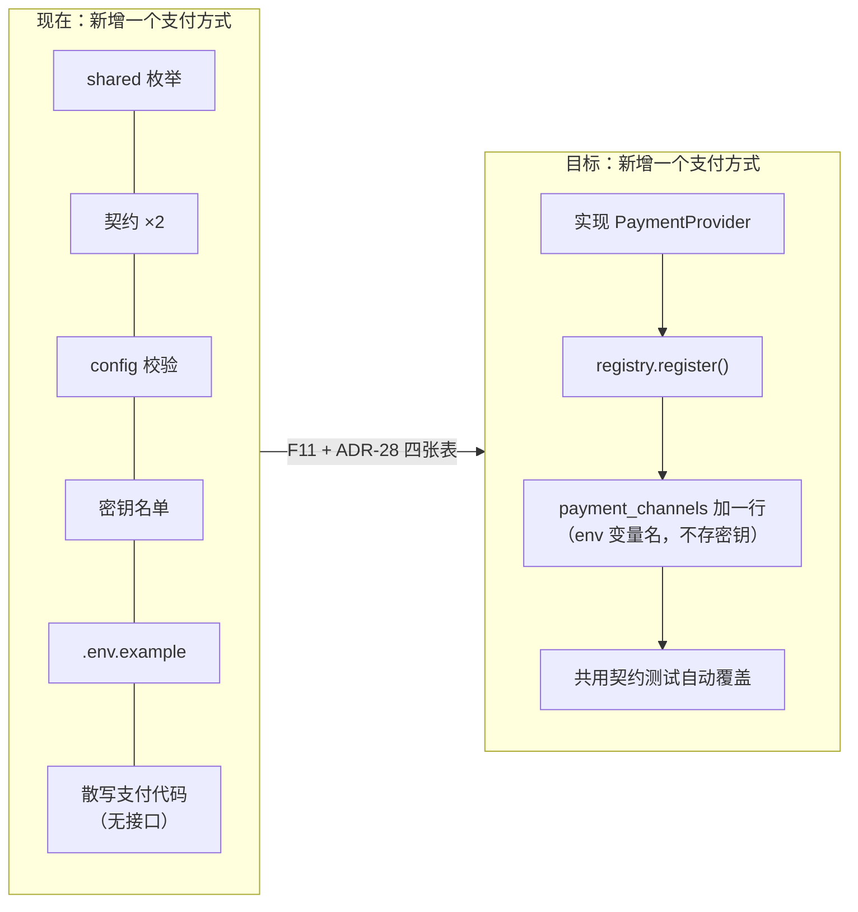

> 📌 **灵活性目前主要停留在文档里**。好消息是：地基的纯函数层（Money、错误码、枚举）已经是"单一真源"的写法，改造时不用推倒；需要补的是"注册表 + 国家档案 + 通道表 + 用例层"这四块——也就是 F10 / F11 加上 ADR-28 的四张表。这里有一个需要您拍板的前置决策：**是否现在就升级技术文档 v0.6 / 契约 0.6.0，把四张表纳入**（001 迁移注释里写了必须先改文档再扩表）。

---

## 5. 解决方案

### 5.1 优先级总览

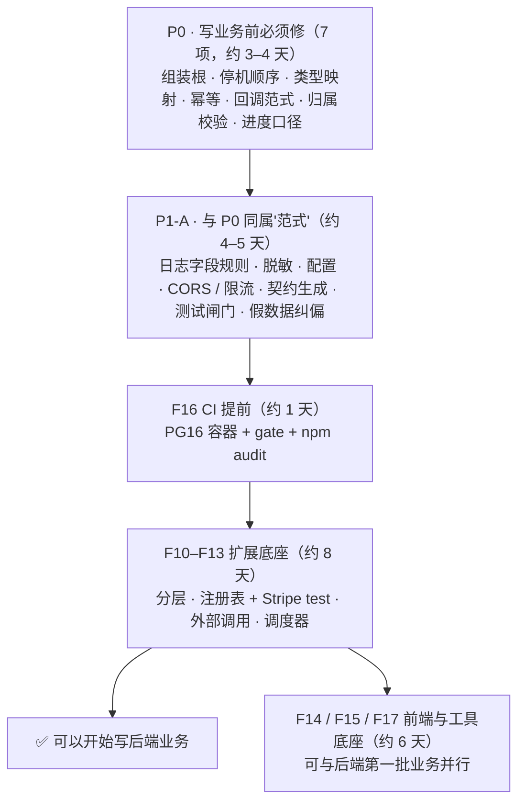

> 📌 从现在到"可以开始写后端业务"约 **17–18 个工作日**；前端底座可以与后端第一批业务并行。

### 5.2 P0 解决方案

#### P0-1　建立组装根（生产入口）

**目标：** 测试与生产走**同一个**装配函数；生产能 `npm run build && npm start`。

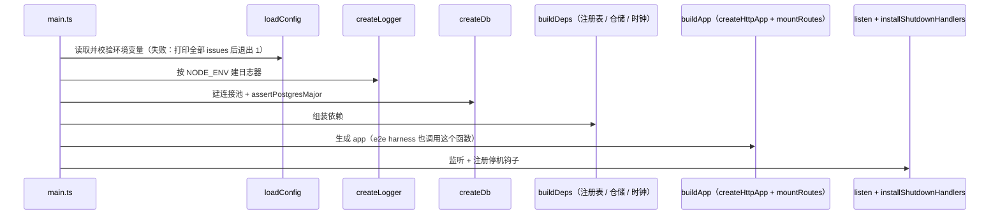

要点：

1. 新增 `server/src/compose.ts`：导出 `buildDeps(config)` 与 `buildApp(deps)`；`test/e2e/harness.ts` 改为调用它们，不再自己拼。
2. 新增 `server/src/main.ts`：只做上图的顺序调用，不含任何逻辑。
3. 构建：`tsc -b`（server 与 shared 用 project references 输出 `dist/`）或 esbuild 打包为单文件；`packages/shared` 的 `main` 改指向构建产物，或用 `exports` 同时声明源码（开发）与产物（生产）。
4. 新增 `/readyz`：检查 DB `ping` + 未处于停机中；`/healthz` 保持"只报进程活着"。
5. **冒烟测试（L3）**：子进程启动 `node dist/main.js` → 请求 `/healthz`、`/readyz` → 发 SIGTERM → 断言 N 毫秒内退出码 0。这条测试同时守住 P0-2。

#### P0-2　停机顺序

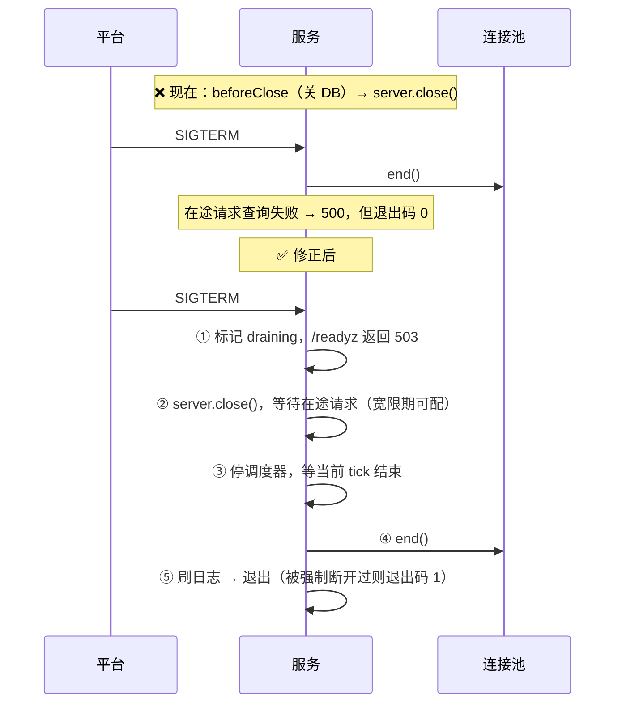

- `ShutdownHooks` 拆成 `beforeDrain`（停调度器接新任务）与 `afterDrain`（关 DB、刷日志）两个钩子，名字直接表达先后。
- 宽限期进配置（例如 `SHUTDOWN_GRACE_MS`），默认值要小于平台给的停机宽限。
- 回归测试：就用本次的探针形态——慢请求在途时发 SIGTERM，断言该请求 **200** 且退出码 0；再构造一个超过宽限期的请求，断言退出码 **1**。

#### P0-3　数据库类型映射

```ts
// db.ts：BIGINT 统一解析为 number，并守住安全整数边界（金额以円为单位，远小于 2^53）
const int8 = {
  to: 20, from: [20],
  serialize: (x: number) => String(x),
  parse: (x: string) => {
    const n = Number(x);
    if (!Number.isSafeInteger(n)) throw new Error(`int8 超出安全整数：${x}`);
    return n;
  },
};
postgres(url, { types: { int8 } });
// NUMERIC（汇率）保持字符串：交给 toRateInt(string) 做精确转换，这是刻意的
```

- 在 `db.ts` 顶部注释写清"数据库 → JS 的类型约定表"（int4 / int8 → number；numeric → string；timestamptz → Date；jsonb → object）。
- 用例：`select 9007199254740993::int8` 必须抛错；`select 1000::bigint + 0` 读回 `number 1000`；`count(*)` 读回 number。

#### P0-4　幂等执行器重做

按"handler 有没有外部副作用"分两种模式：

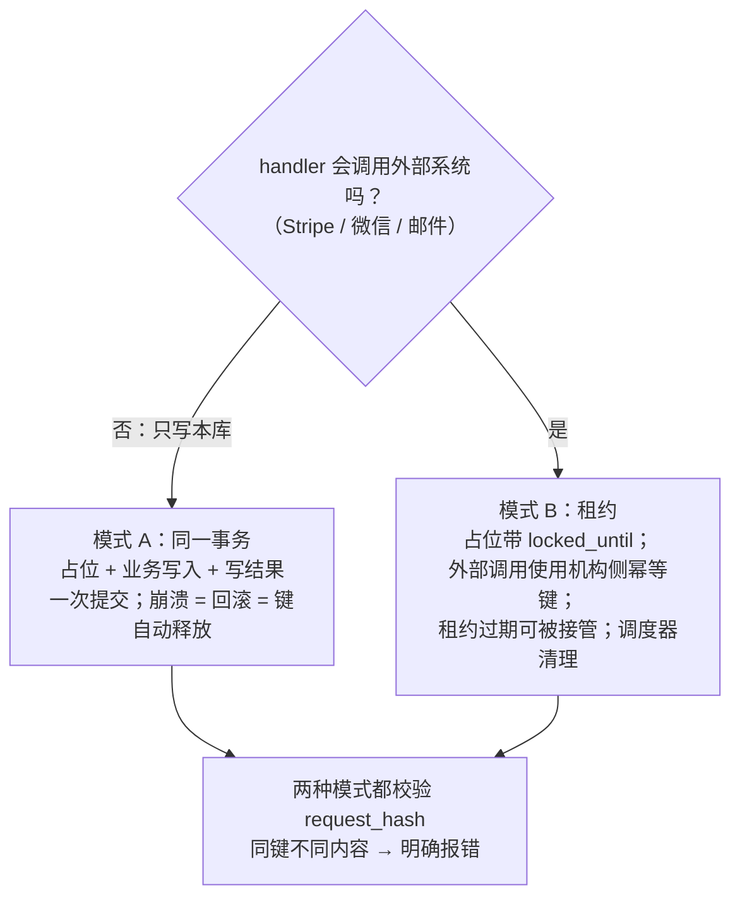

- 迁移 003：`idempotency_keys` 加 `request_hash`、`locked_until`、`completed_at`。
- 模式 A 的关键事实：Postgres 里，另一个未提交事务已插入同一唯一键时，`insert … on conflict do nothing` 会**等待**对方提交或回滚——提交则本方拿到"已存在"，回滚则本方插入成功。这正好就是需要的语义，不必轮询。
- 模式 B 的接管：`update … set locked_until = now() + 租约 where key = $1 and status_code = 0 and locked_until < now() returning key`。
- 指纹：`sha256(method + route + 规范化 body)`；不一致时返回新错误码（例如 **42201**「幂等键已用于不同请求」），需同步技术文档 §7、契约与 shared 注册表（错误码三处同源的既有流程）。
- 故障注入用例：占位后抛出"模拟崩溃"且不走 catch → 模式 A 断言键已释放；模式 B 断言租约过期后可接管。

#### P0-5　回调处理范式

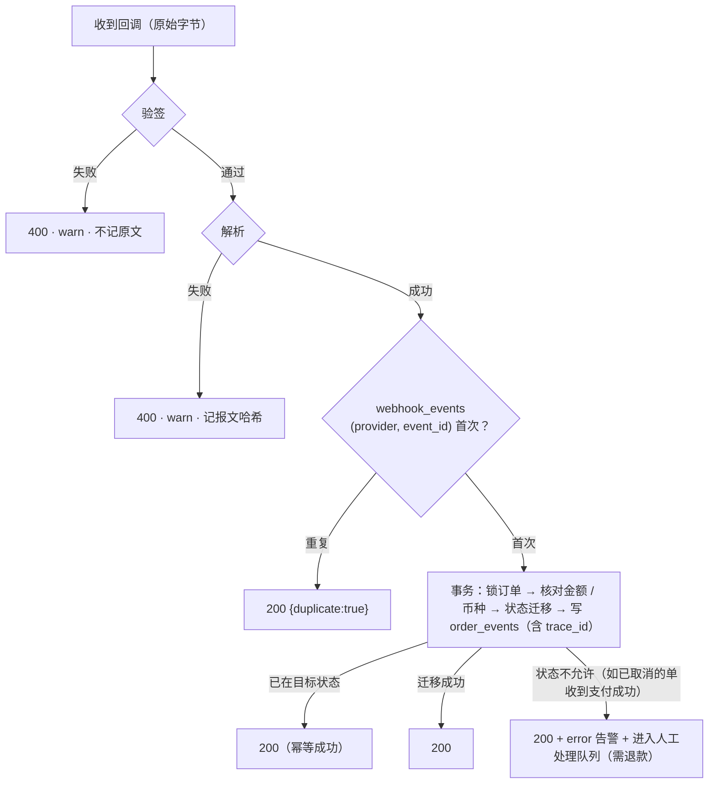

- **原则：对支付机构，业务冲突一律回 2xx 并在我方告警；只有"验签失败 / 报文不可解析"回 4xx。** 回 409 / 500 只会换来重试，不会换来正确结果。
- 现在验签失败用的是 50002，按"码前三位 = HTTP 状态"会返回 **500**；建议改为 4xx 码（新增或复用，走三处同源流程）。
- 新表 `webhook_events(provider, event_id, received_at, payload_sha256, processed_at, result)`，主键 `(provider, event_id)`；同时也是"回调到了没有"的对账依据。
- Stripe 按 D-49 以 `checkout.session.completed` / `checkout.session.async_payment_succeeded` / `checkout.session.async_payment_failed` / `checkout.session.expired` 为主事件；样本工厂同步补齐（见 P1）。
- 把这套流程写成通用的 `handleProviderCallback(provider, rawBody, headers)`，骨架的 mock 回调先迁到它上面，F11 的 Stripe 直接复用。

#### P0-6　归属校验与骨架闸门

- 所有"按 id 取用户资源"的查询必须带 `user_id = 当前用户`，**查不到返回 404 而非 403**（不暴露资源是否存在）。在仓储层提供 `findOwnedOrder(tx, userId, orderId)` 这类函数作为唯一入口，路由里不再手写 SQL。
- 骨架路由只在 `ENABLE_SKELETON=on` 且非生产时挂载；跨字段校验里加一条"生产环境开启骨架 → 拒绝启动"。
- 回归用例：本次探针的两条（B 读 A → 404；B 模拟支付 A → 404，A 的订单状态不变）。

#### P0-7　进度口径

- 把 `地基搭建清单` §6.0 的进度表改成"逐验收项打勾"：每个 F 项下列出清单"怎么验证"栏的每一条，✅ 必须每条都有对应用例或证据链接。
- 立即更正：F0 / F1 / F2 / F3 / F5 / F6 / F6b / F7 / F8 改为 🟡，并写明缺哪几条；F9 的描述更新到 F9-d1。
- 本报告 §2 的表可以直接作为改表的底稿。

### 5.3 P1 解决方案（按主题）

**日志**

| 项 | 方案 |
|---|---|
| 保留字段只认上下文（D8） | emit 组装顺序改为 `{...base, ...去掉保留键的 fields, ...context, event}`；调用点传了保留键时，开发环境抛错、生产环境改名为 `field_trace_id` 并记一条 warn |
| module 由 child 决定（D9） | http 中间件不再往上下文写 `module`；访问日志自己带 `module:'http'` |
| 键名匹配（D10） | 把键按 `_` / 驼峰切成词，再与敏感词表做**整词**比较（`company` 切出 `company`，不再命中 `pan`）；敏感词表保留 `card_no`、`pan` 这类整词 |
| 文本正则（D11） | 卡号：长度 13–19 **且通过 Luhn 校验**才掩码；openid：限定为完整 token 且长度 28，并排除已知内部 ID 前缀；用真实形状的 JAN、毫秒时间戳、ULID 做反例测试 |
| 数字卡号（D12） | 整数且 ≥ 10^12、通过 Luhn 时按卡号处理 |
| 解析错误级别（D13） | `isBodyParseError` 分支先于 `instanceof AppError` 判断，记 warn；超限返回 413（新增或复用错误码） |
| 流 B / C 写入器 | `trackUserEvent(tx, {user_id, event, props})`、`auditAdmin(tx, {actor, action, target, before, after})`，都自动带 trace_id、都过 redact；新增 `/beacon`（批量、限流、schema 校验）并写进契约 |
| 落点与告警 | 选定日志服务（清单已列 Better Stack / Axiom），stdout JSON 直接接入；接 Sentry（server）；保留期 ≥90 天 |
| order_events 带 trace_id | 迁移加列；状态迁移函数自动从上下文取 |

**APPI 与 append-only 的调和（D14）**

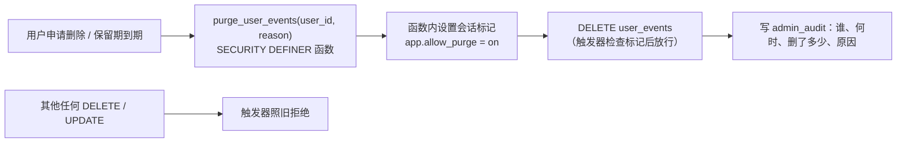

- 订单等有账簿保存义务的数据不删，改为**匿名化**（清空收件人、电话、地址快照中的个人字段，保留金额与时间）。保存年限请与税理士确认后写进隐私政策。

**安全中间件与鉴权**

| 项 | 方案 |
|---|---|
| CORS | 按 `CORS_ORIGINS` 白名单；只对 `/api/v1/admin/*` 开放；回调与小程序接口不需要 CORS |
| 限流 | `RateLimitStore` 端口 + 进程内令牌桶实现（Render 单实例足够）；将来多实例换 Postgres / Redis 实现；键 = IP + 路由（登录）或 user_id + 路由（下单） |
| trust proxy | 设为平台实际代理层数（例如 `1`），并写测试：伪造的第二层 `X-Forwarded-For` 不被采信 |
| 管理员登录与锁定 | `users` 加 `failed_login_count`、`locked_until`；连续 5 次失败锁 15 分钟；每次失败写 admin_audit |
| 口令 72 字节（D15） | 设置口令时按 UTF-8 **字节**长度校验（≤72，否则 40001）；或先做 HMAC-SHA256 再 bcrypt（二选一，写进注释） |
| token 吊销（D25） | `users.token_ver`；改密 / 封禁时 +1；校验时比对 `ver` 并检查 `blocked_at`（结果缓存 60 秒，避免每请求查库） |
| 密钥轮换（D26） | `JWT_KEYS=kid1:密钥,kid2:密钥`，签发用第一把、校验按 `kid` 选；`issuer` 接配置并区分环境 |

**配置**

- `NODE_ENV` 增加 `test`；引入 `isProdLike = staging || production`，除"生产禁 mock"外的跨字段规则都对 staging 生效。
- URL 类字段用 `z.url()`；`INTERNAL_JOB_SECRET` ≥32 字符；`ADMIN_INITIAL_PASSWORD` ≥12 字符（与 `.env.example` 对齐）。
- `HOST` 只从 config 读，`defaultHost()` 删除或改为读 config。
- `DUTY_RATE_US` 这类"按国家命名的变量"随 `duty_rates` 表落地而移除（config.ts 注释里已标为迁移期保留项）。

**契约**

- 用 `openapi-typescript` 生成 `packages/shared/src/api.gen.ts`；gate 里重新生成并 `git diff --exit-code`，手改 yaml 不重新生成即红（F2 验收项）。
- `check-contract.mjs` 改为解析 YAML：错误码**双向**比对；所有 shared 枚举逐一比对；每个已挂载路由必须在契约中出现（内部 / 骨架路由走豁免名单）。

**测试基础设施**

- 测试库闸门：库名必须以 `_test` 结尾、主机必须是本机，否则拒绝 `truncate`（除非显式 `ALLOW_REMOTE_TEST_DB=1`）。
- `passWithNoTests` 改为 `false`；迁移以 `stdio: 'pipe'` 运行、失败时打印输出；`afterAll` 用 `await db?.end()`。
- 迁移 up → down → up 用例：比较两次 up 后的 `information_schema` 快照一致。
- 100% 闸门扩大到 `redact.ts`、`idempotency.ts`；`auth.ts` 分支 ≥95%。
- 故障注入工具：`crashAfter(stepName)` 帮助函数，配合 P0-4 / P0-5 的用例。
- pre-commit（`simple-git-hooks` + `lint-staged`）：改动文件 lint + typecheck + `test:fast`；超过 30 秒打印告警。
- gate 去重：`lint → typecheck → check:contract → test:contract → cov（unit + db + e2e 一次跑完）`。

**假数据纠偏**

- 删除清酒 SKU，换成非酒类的日本食品（如抹茶粉、调味料）；类目改为契约枚举内的值；加一条"工厂产物的 `compliance_tags` 不得含上架即拒标签"的测试。
- 运费阶梯只保留**一份**数据源（seed 文件），技术文档测试向量、工厂、业务代码都从它读；先请您确认以哪份数字为准。
- `pickTier()` 移到 domain（shared），测试引用它。
- 美国地址补齐边界样本（O'Brien、APO / FPO、PO Box、HI / AK、ZIP+4、超长 line2）。
- JAN 生成带校验位的真实形状；openid 生成 28 位真实形状。
- Stripe：修 `overrides` 合并缺陷；补 `checkout.session.*` 四个事件；`api_version` 与账户实际固定的版本一致并在注释记录来源。

**小程序**

- 补 `project.config.json` / `sitemap.json`；按清单 F14 迁到官方 TS 模板，或至少 `checkJs` + 从 shared 生成的 JS 常量。
- 幂等键在"一次用户意图"开始时生成，存在页面状态里，重试复用。
- `wx.request` 设超时（例如 15 秒）；40101 静默重登并**只重放一次**。
- `envVersion` → API 地址映射；`App.onError` / `onUnhandledRejection` → `/beacon`。
- stylelint 禁止页面 wxss 出现色值 / px 字面量（只允许 `var(--ws-*)`）。

### 5.4 P2 清单

| 项 | 方案 |
|---|---|
| async 路由样板（A4） | 删除 `void (async () => …)()`，直接 `async (req, res) => {}`（Express 5 自动转交错误） |
| 订单号冲突（D32） | 唯一冲突时重试 3 次；随机源换 `crypto.randomInt` |
| 币种小数位 | 币种表带 `minor_unit`；`CurrencyCode` 与 `CURRENCY` 合并为一处 |
| 邮箱大小写（D19） | `lower(email)` 唯一索引 |
| `updated_at` 触发器（DB7） | 通用 `set_updated_at()` 触发器 |
| 访问日志字段（D22） | 加 `client_ip`、`resp_bytes`；`actor` 记 `user:<id>` |
| 4xx 双行日志（L8） | `request_rejected` 降为 debug，或合并进访问日志 |
| `.env.example` 过时注释 | "技术文档 v0.4" → v0.5；`SCHEDULER_TICK_MS` 注释写"不是 Render Cron Job"、`INTERNAL_JOB_SECRET` 注释又写"每日 Cron Job 调用"，两处需统一口径 |
| 成功判定（D34） | 在契约里约定成功体格式并让 request.js 按契约判断 |
| 安全响应头 | 加 `X-Content-Type-Options: nosniff` 等 |
| ESLint 升级 | F16 接入 Dependabot 时一并处理 |

### 5.5 路线图

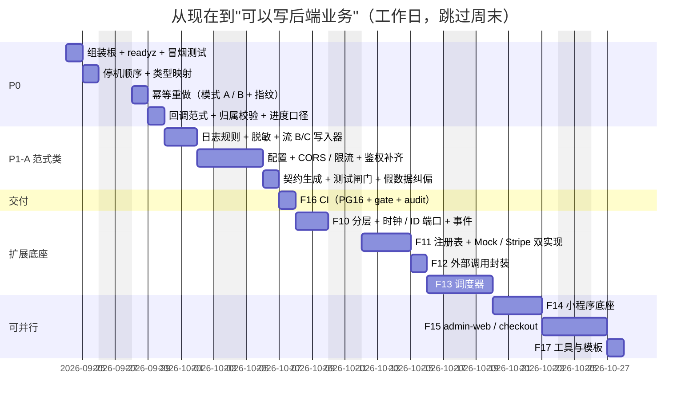

> ⚠️ F11 依赖一个决策：ADR-28 四张表是否纳入技术文档 v0.6 / 契约 0.6.0（见 §6）。不拍板，F11 只能做"注册表 + 接口"，国家档案和通道表做不了。

### 5.6 每一项修复的验收口径（沿用您的约束八）

每个修复单元都按同一个格式交付：


---

## 6. 需要您拍板的事项

| # | 事项 | 建议 | 影响 |
|---|---|---|---|
| 1 | ADR-28 四张表（country_profiles / payment_channels / app_config / duty_rates）是否现在纳入技术文档 v0.6 与契约 0.6.0 | **现在做**：它是"支付可插拔、国家可扩展"唯一的数据落点 | 不定则 F3 / F11 只能做一半 |
| 2 | 用户行为数据的保留期与删除方式 | `user_events` 保留期定一个数（例如 180 天）+ 受控删除函数；订单数据匿名化 | APPI 合规与隐私政策文案 |
| 3 | 日志落点服务 | 在清单已列的候选里选一个，按免费额度起步 | F5 能否算完成 |
| 4 | 运费阶梯以哪份数字为准 | 以最新的运费报价为准，写成唯一 seed | 假数据与业务报价一致 |
| 5 | 成功响应体格式 | 成功体不带 `code`（维持现状），写进契约 | 小程序判定逻辑 |
| 6 | 进度表口径 | 采用"逐验收项打勾"，✅ 必须全勾 | 决策依据可信 |

---

## 7. 做得好的地方（请保留）

1. **注释质量**：几乎每个模块都有 `@why / @limitation / @tradeoff`，而且写的是真实的失败经历（"曾经写成……复现缺陷 #5"）。CLAUDE.md 约束六落实得很好。
2. **红灯证据制度**：附录 B / C 每条修复都有"注回缺陷后失败 N 条"，还诚实记录了"外键索引用例没变红、原因是部分索引掩盖"这种自我纠错。这比覆盖率数字更有价值。
3. **结构不变量元测试**：对新表自动生效，把"人会忘"变成"机器会拦"。
4. **金额口径**：×1e8 整数汇率、整数商余 half-up、属性测试、只造 JPY 零小数样本——跨境支付最容易出事故的地方处理得很稳。
5. **错误码三处同源 + 字面量类型**：拼错码在编译期报红。
6. **回调原始字节 + 常量时间比较 + 独立实现交叉验签**：验签这件事的方法论是对的。
7. **配置"变量名集合比对"**：拼错环境变量名这种"永远不报错"的问题被结构性消除。
8. **第一轮评审后的 20 条修复（附录 B 10 条 + 附录 C 10 条）全部到位**，本次复核未发现回退。

> 📌 这些是"习惯"层面的资产，比任何一段代码都难得。解决方案里的每一项都应沿用这些习惯来做。

---

## 附录 A：探针清单（可直接改写为回归用例）

| 探针 | 层 | 对应缺陷 |
|---|---|---|
| 脱敏：JAN / 毫秒时间戳 / o_ 前缀 ID / 业务键名 / 数字卡号 / 裸手机号 | unit | D10 / D11 / D12 |
| 日志：上下文内 child({module}) 与调用点传 trace_id / user_id | unit | D8 / D9 |
| `allocate` 负总额、负权重、零权重 | unit | D18 |
| 配置：NODE_ENV=test、staging 坏 URL 与短密钥、生产缺 Stripe 密钥 | unit | D16 / D17 |
| bcrypt：72 字节后不同的两个口令 | unit | D15 |
| JWT：issuer 不符（结果：正确拒绝 40101，无缺陷） | unit | — |
| DB：int4 / int8 / count / numeric / timestamptz / jsonb 的 JS 类型 | e2e（真库） | D2 |
| DB：statement_timeout、邮箱大小写、user_events 删除 | e2e（真库） | D19 / D20 / D14 |
| 幂等：遗留占位、同键不同内容 | e2e（真库） | D3 / D4 |
| HTTP：越权读 / 越权模拟支付、重复回调、坏 JSON 回调、`/readyz`、CORS 预检、2MB 报文 | e2e（真端口） | D5 / D6 / D7 / D13 / D21 |
| 停机：慢请求在途时 SIGTERM | e2e（真端口 + 真库） | D1 |

探针在隔离副本中运行，**未写入仓库**。复跑方式：在任意 Linux / macOS 环境 `npm ci`，准备一个 PG ≥16 的库并设置 `TEST_DATABASE_URL` / `TEST_ADMIN_DB_URL`，按上表把断言写成用例即可。

## 附录 B：评审基线

| 项 | 值 |
|---|---|
| 提交 | `b8eeec4`（2026-09-22 19:37 -0700） |
| Node | 22.23.2（`.nvmrc` 为 22.22.2，同一大版本） |
| 数据库 | 嵌入式 PostgreSQL 18（仓库要求 ≥16，生产目标 16） |
| 代码规模 | 源码 2,312 行 · 测试 4,615 行 · 小程序 544 行 · 迁移 352 行（测试 : 源码 ≈ 2 : 1） |
